# Deploying Auth-providers to AWS (ECS Fargate + ALB + RDS + Amplify)

A step-by-step record of a production-style deployment of this project, done by hand in the AWS console.
Every step lists the exact values that were used, why the step is needed, and the pitfalls that came up.
Screenshots show the finished state of each resource.

Placeholders used below (the screenshots are masked the same way):

| Placeholder | Meaning |
|---|---|
| `<account-id>` | 12-digit AWS account id (shown as `1234-5678-9012` / `123456789012` on screenshots) |
| `<rds-endpoint>` | `auth-provider-db.<hash>.eu-west-1.rds.amazonaws.com` |
| `<ref>` | Supabase project ref |
| `<github-user>` | GitHub owner of the repository |

## Contents

0. [Architecture](#architecture)
1. [AWS account and region](#1-aws-account-and-region)
2. [Domain](#2-domain)
3. [DNS: Route 53 hosted zone](#3-dns-route-53-hosted-zone)
4. [CLI access](#4-cli-access)
5. [Terraform state bucket (S3)](#5-terraform-state-bucket-s3)
6. [TLS certificate (ACM)](#6-tls-certificate-acm)
7. [ECR repository and the first image](#7-ecr-repository-and-the-first-image)
8. [VPC](#8-vpc)
9. [Security groups](#9-security-groups)
10. [RDS PostgreSQL](#10-rds-postgresql)
11. [ECS cluster](#11-ecs-cluster)
12. [IAM: task execution role](#12-iam-task-execution-role)
13. [App config: SSM Parameter Store + Secrets Manager](#13-app-config-ssm-parameter-store--secrets-manager)
14. [Task definition](#14-task-definition)
15. [Target group](#15-target-group)
16. [Application Load Balancer](#16-application-load-balancer)
17. [DNS record for the API](#17-dns-record-for-the-api)
18. [ECS service](#18-ecs-service)
19. [Frontend on AWS Amplify](#19-frontend-on-aws-amplify)
20. [Wiring frontend and backend together](#20-wiring-frontend-and-backend-together)
21. [Production hardening](#21-production-hardening)
22. [Cache (Valkey) and media storage (S3)](#22-cache-valkey-and-media-storage-s3)
23. [Verification](#23-verification)
24. [Costs and pausing overnight](#24-costs-and-pausing-overnight)
25. [Notes for Terraform](#25-notes-for-terraform)
26. [Troubleshooting](#26-troubleshooting)

## Architecture

```
Browser ─► app.dimak-auth.xyz ─► AWS Amplify (React build, Amplify-managed TLS)
   │
   └─► api.dimak-auth.xyz ─► Route 53 alias ─► ALB :443 (ACM cert, public subnets)
                                                 │  :80 → 301 to :443
                                                 ▼
                                    Target group (type IP, HTTP 8000, /healthz)
                                                 ▼
                         ECS Fargate service "api" (2–4 tasks, private subnets)
                              │                         │
                              ▼                         ▼
                   RDS PostgreSQL (private)     NAT gateway → internet
                   Valkey Serverless (private)  (ECR API, JWKS, CloudWatch)
                   S3 gateway endpoint ← ECR image layers, media bucket

Browser ─► presigned PUT/GET ─► S3 media bucket (order photos)
```

| Layer | Resource | Name |
|---|---|---|
| DNS | Route 53 public hosted zone | `dimak-auth.xyz` |
| TLS | ACM certificate | `dimak-auth.xyz` + `*.dimak-auth.xyz` |
| State | S3 bucket | `dimak-auth-tfstate-<account-id>` |
| Images | ECR repository | `auth-providers-api` |
| Network | VPC `10.0.0.0/16` | `auth-provider-vpc` |
| Database | RDS PostgreSQL 18.3 | `auth-provider-db` |
| Cache | ElastiCache Serverless (Valkey 8) | `auth-providers` |
| Media | S3 bucket | `auth-providers-media-<account-id>` |
| Config | SSM parameters | `/auth-providers/api/*` |
| Compute | ECS cluster / service | `auth-providers` / `api` |
| Entry | ALB / target group | `auth-providers-alb` / `auth-providers-api` |
| Frontend | Amplify app | `Auth-providers`, branch `main` |
| Alerts | SNS topic / CloudWatch alarm | `auth-providers-alerts` / `api-5xx` |

Region: **eu-west-1 (Ireland)** for everything regional.

---

## 1. AWS account and region

- On a fresh account **all regions were greyed out**, while Route 53 already worked.
  Route 53 (like IAM, CloudFront, Organizations) is a **global** service, so it works before the account is fully
  activated. ACM, ECR, ECS, RDS, ALB and VPC are **regional** and stay blocked until AWS finishes activation
  (payment method + identity check, up to 24 hours).
- The first emails after signup are unrelated (Cost Explorer, Cost Anomaly Detection). The account was unblocked on
  its own a few hours after signup; then regions became selectable.
- Region choice: **eu-west-1 (Ireland)**. The cheapest regions are us-east-1 / us-east-2 / us-west-2 and, in Europe,
  eu-west-1 and eu-north-1; Frankfurt (eu-central-1) is ~5–15% more expensive. For this setup the difference is a few
  dollars a month (ALB, NAT and RDS cost about the same everywhere). Ireland gets new features early and has low
  latency from Europe.

## 2. Domain

- Registrar: **Porkbun** (cheap, popular, free WHOIS privacy). Domain: `dimak-auth.xyz`.
  `.xyz` / `.site` / `.online` are the cheapest TLDs for the first year; renewal costs more.
- Why not a free DNS service such as DuckDNS: an ALB has **no static IP** (only a DNS name), and DuckDNS supports only
  A records, no CNAME. ACM also can't validate a certificate there, because its DNS validation needs a CNAME record.

## 3. DNS: Route 53 hosted zone

Why: Route 53 serves DNS for the domain, so ACM can validate the certificate automatically and records can point at
the ALB with an alias.

1. Route 53 → **Hosted zones** → **Create hosted zone**:
   - Domain name: `dimak-auth.xyz`
   - Type: **Public hosted zone**
2. Open the zone, copy the 4 values of the **NS** record.
3. Porkbun → Domain Management → the domain → **Authoritative Nameservers** → paste the 4 servers
   **without the trailing dot** (`ns-404.awsdns-50.com`, not `ns-404.awsdns-50.com.`).
4. Check that public DNS sees them:
   ```powershell
   nslookup -type=NS dimak-auth.xyz 8.8.8.8
   ```
   Expected: four `awsdns` servers.
   - Right after registration Google DNS may still answer *Non-existent domain* (cached NXDOMAIN) for up to ~1 hour.
     The registry itself can be checked earlier via RDAP:
     `https://rdap.centralnic.com/xyz/domain/dimak-auth.xyz` — it showed the AWS nameservers first.
   - On a Windows with a non-English locale `nslookup` prints a localized *Non-authoritative answer*. That only means
     the reply came from a resolver cache; it is not an error.

**Decision:** the hosted zone is created **once** and is **not** part of the destroy/recreate cycle. Every new hosted
zone gets new NS servers, which would have to be changed at the registrar again. Terraform looks it up with
`data "aws_route53_zone"` instead of creating it.

The finished zone (records are added in later steps: the ACM validation CNAME in §6, the `api` alias in §17,
the Amplify records in §19):

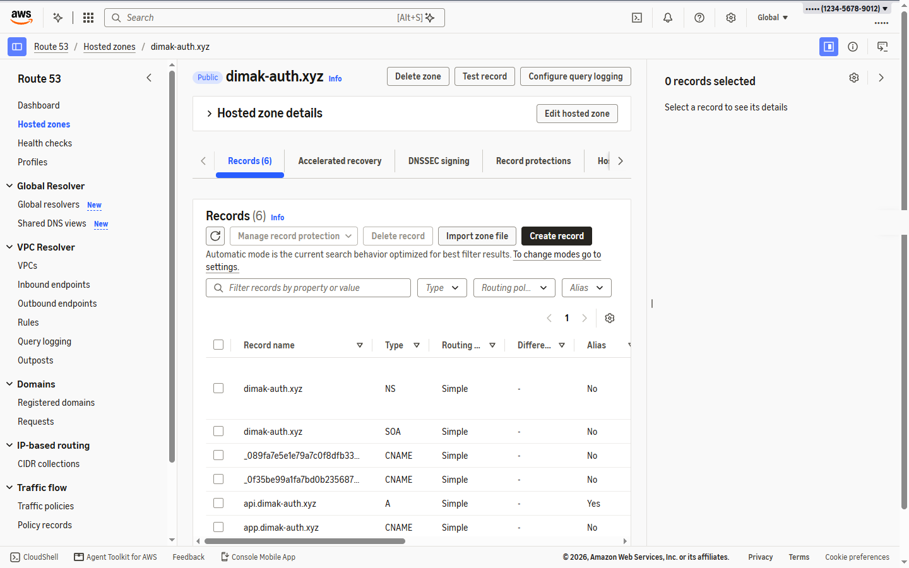

| Record | Type | Created in |
|---|---|---|
| `dimak-auth.xyz` | NS, SOA | automatically with the zone |
| `_<hash>.dimak-auth.xyz` | CNAME | §6 ACM validation |
| `_<hash>.dimak-auth.xyz` (second) | CNAME | §19 Amplify certificate validation |
| `api.dimak-auth.xyz` | A (alias → ALB) | §17 |
| `app.dimak-auth.xyz` | CNAME → CloudFront | §19 Amplify custom domain |

## 4. CLI access

- Log in with the browser flow (AWS CLI ≥ 2.32): short-lived credentials, no access keys on disk.
  ```powershell
  aws login --profile dev
  aws sts get-caller-identity --profile dev
  ```
  The profile in `~/.aws/config` gets `login_session = <principal ARN>`.
- Note: this session was the **root** user. Moving daily work to an IAM Identity Center user is still to do.

## 5. Terraform state bucket (S3)

Why: Terraform will keep its state here later. It is created by hand on purpose: Terraform can't keep its state in a
bucket it creates itself.

S3 → **Create bucket**, region eu-west-1:

| Field | Value |
|---|---|
| Bucket name | `dimak-auth-tfstate-<account-id>` (the account id keeps the name globally unique) |
| Object Ownership | ACLs disabled |
| Block Public Access | **Block all public access** on |
| Bucket Versioning | **Enable** |
| Default encryption | SSE-S3 |

Check:
```powershell
aws s3api get-bucket-versioning --bucket dimak-auth-tfstate-<account-id> --profile dev
# → "Status": "Enabled"
```

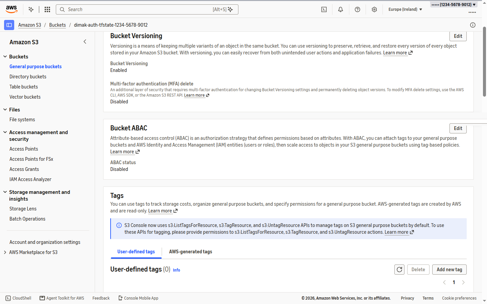

## 6. TLS certificate (ACM)

Why: the ALB terminates HTTPS with this certificate. It must be in the **same region as the ALB** (eu-west-1).

1. Certificate Manager (eu-west-1) → **Request a certificate** → **Request a public certificate**:
   - Fully qualified domain names: `dimak-auth.xyz` and `*.dimak-auth.xyz`
     (the wildcard covers `api.`, `app.` and any future subdomain);
   - Validation method: **DNS validation**;
   - Key algorithm: **RSA 2048**.
2. Status is now `PENDING_VALIDATION`. Both names share **one** validation CNAME (`_<hash>.dimak-auth.xyz`), which has
   to exist in the hosted zone.
3. Open the certificate → **Create records in Route 53** → select both domains → **Create records**.
   Without this click the status stays `PENDING_VALIDATION` forever.
4. A few minutes later: status **Issued**, both `dimak-auth.xyz` and `*.dimak-auth.xyz` → **Success**.

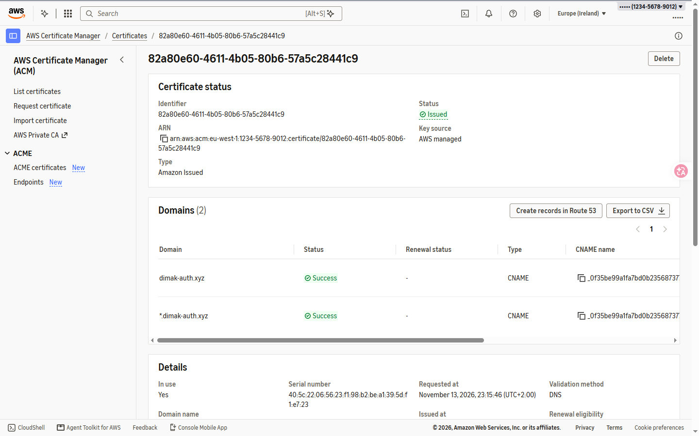

## 7. ECR repository and the first image

Why: ECS pulls the container image from ECR.

### 7.1 Repository

ECR → **Private registry** → **Repositories** → **Create repository**:

| Field | Value |
|---|---|
| Repository name | `auth-providers-api` |
| Image tag mutability | **Immutable** |
| Mutable tag exclusions | empty (no exception such as `latest`) |
| Encryption | AES-256 |
| Scan on push | on (basic scanning) |

Immutable tags: a tag (git SHA) can never be moved to another image, so a task definition that references a tag always
gets the same image.

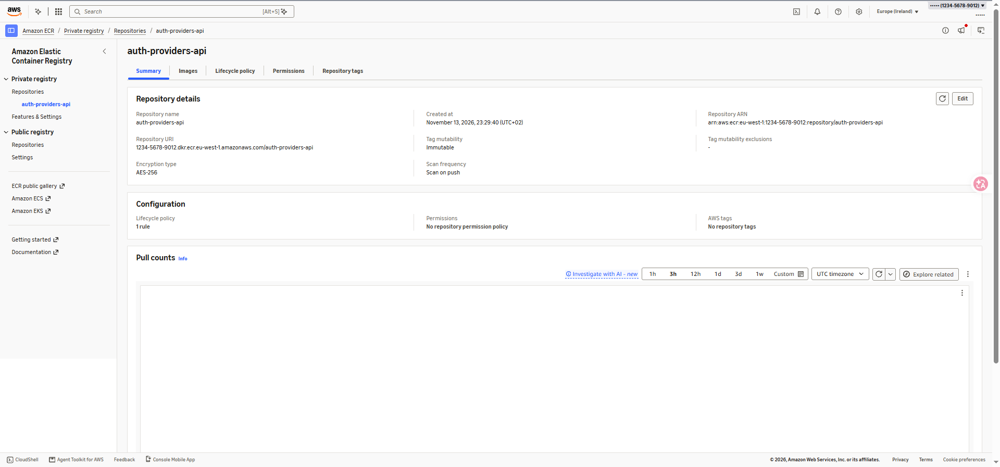

### 7.2 Lifecycle policy

Repository → **Lifecycle policy** → **Create rule**:

| Field | Value |
|---|---|
| Rule priority | 1 |
| Image status | **Any** |
| Match criteria | **Image count more than** `10` |
| Action | expire |

With *Image status: Tagged* the console demands a tag filter ("One or more filter required when using tagged status"),
so *Any* is used.

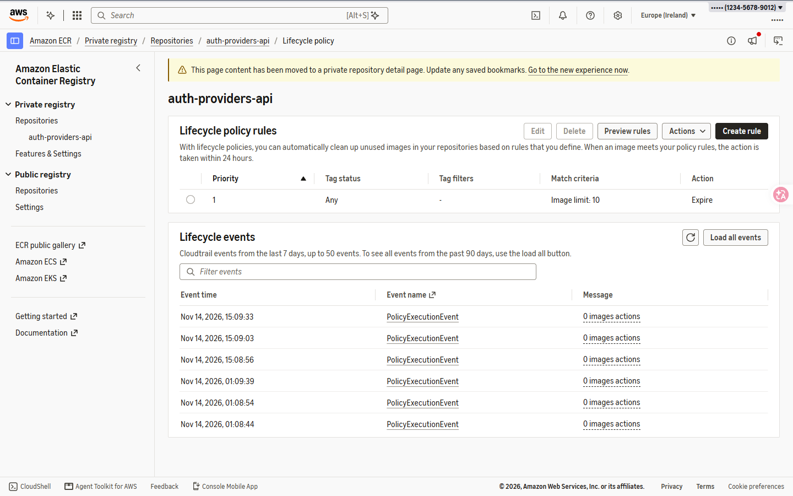

### 7.3 Build and push (PowerShell)

```powershell
$ACCOUNT = "<account-id>"; $REGION = "eu-west-1"
$REPO = "$ACCOUNT.dkr.ecr.$REGION.amazonaws.com/auth-providers-api"
$TAG = git rev-parse --short HEAD

aws ecr get-login-password --region $REGION --profile dev |
  docker login --username AWS --password-stdin "$ACCOUNT.dkr.ecr.$REGION.amazonaws.com"

docker build --platform linux/amd64 --provenance=false --sbom=false -t "${REPO}:$TAG" .
docker push "${REPO}:$TAG"
```

- `--platform linux/amd64`: the task definition uses Linux/X86_64.
- Dockerfile lint warning *FromAsCasing*: write `FROM ... AS builder` (upper-case `AS`).
- **Pitfall: provenance attestation.** Without `--provenance=false --sbom=false` Docker buildx attaches an attestation by
  default, so the tag points to an **OCI image index**, and ECR shows two extra untagged entries (the image manifest and
  a ~1.5 KB attestation). Basic scanning doesn't scan an index, so *Scan on push* gave no results.
  Fix: delete the three entries (tags are immutable, so a tag can only be reused after deletion) and push again with the
  two flags. Now the repository holds a single tagged image manifest per push and the scan returns findings.

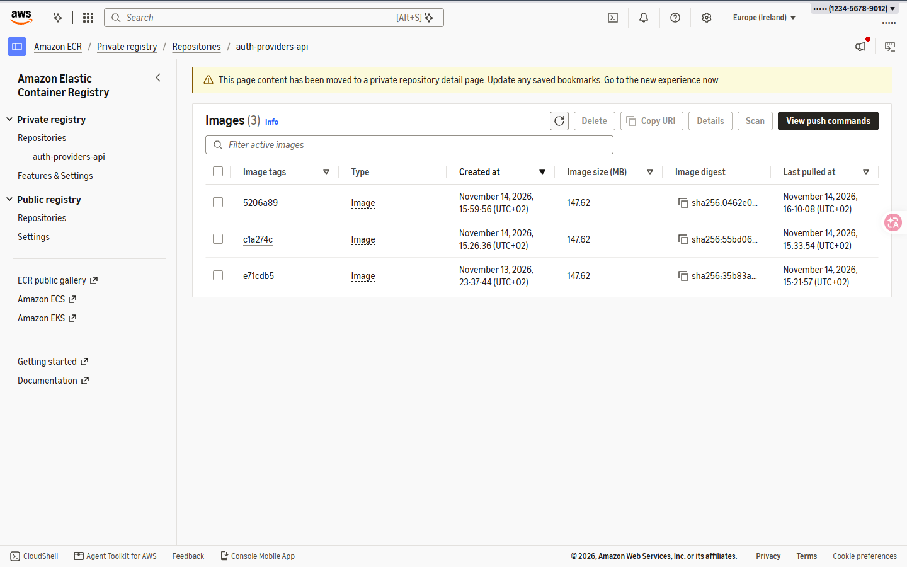

## 8. VPC

Why: the database and the tasks must live in **private** subnets; only the load balancer is public.

### 8.1 VPC

VPC → **Create VPC** → **VPC only**:

| Field | Value |
|---|---|
| Name | `auth-provider-vpc` |
| IPv4 CIDR | `10.0.0.0/16` |
| IPv6 | none |
| Tenancy | default |

- A `/24` VPC would leave only ~59 usable IPs per subnet; every Fargate task takes an IP, an ALB needs 8 free IPs per
  subnet, and a VPC CIDR can't be grown later.
- The default VPC (`172.31.0.0/16`) is not used: all its subnets are public.
- After creation: VPC → Actions → **Edit VPC settings** → **Enable DNS hostnames** on (DNS resolution is on by default).

A subnet is "public" or "private" **only** because of the route table it is associated with. The rest of this section
builds that by hand.

### 8.2 Subnets

VPC → **Subnets** → **Create subnet**, VPC `auth-provider-vpc`, all four in one form:

| Name | AZ | CIDR | Role |
|---|---|---|---|
| `public-1` | eu-west-1a | `10.0.1.0/24` | ALB |
| `public-2` | eu-west-1b | `10.0.2.0/24` | ALB |
| `private-1` | eu-west-1a | `10.0.10.0/24` | ECS tasks, RDS |
| `private-2` | eu-west-1b | `10.0.11.0/24` | ECS tasks, RDS |

Two AZs are required: an ALB and an RDS subnet group both need subnets in at least two AZs.

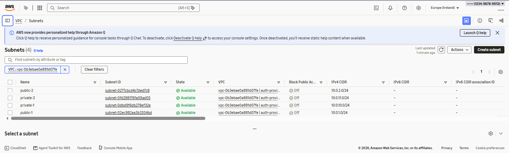

### 8.3 Internet gateway

VPC → **Internet gateways** → **Create internet gateway** → then **Actions → Attach to VPC** → `auth-provider-vpc`.

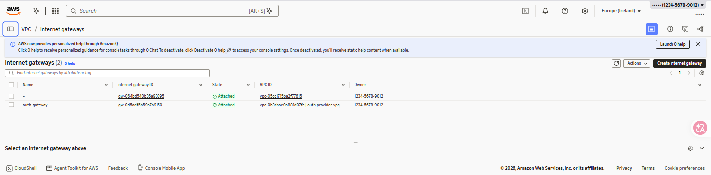

### 8.4 Public route table

VPC → **Route tables** → **Create route table**: name `auth-public`, VPC `auth-provider-vpc`.

- **Routes** → Edit routes → add `0.0.0.0/0` → target **Internet Gateway** → `igw-…`.
  (`10.0.0.0/16 → local` is always there.)
- **Subnet associations** → *Explicit subnet associations* → **Edit** → `public-1`, `public-2`.

The IGW route only gives internet access to resources that have a public IP (the ALB and the NAT gateway do).

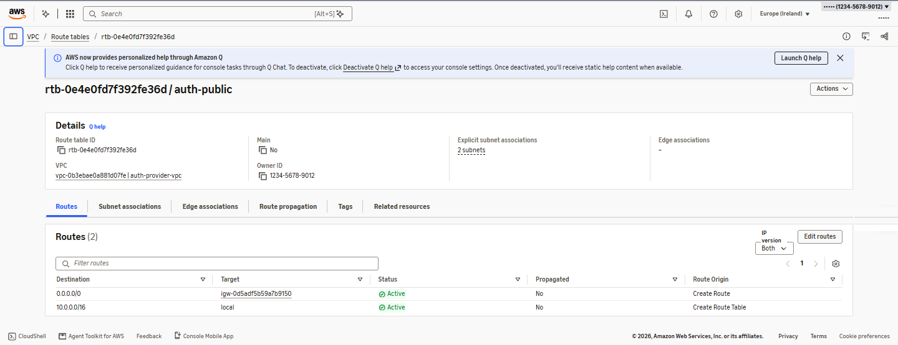

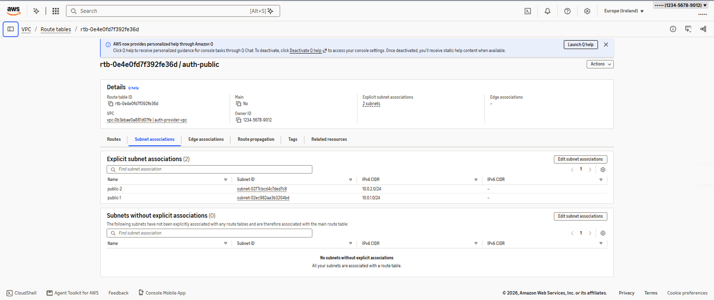

### 8.5 NAT gateway

VPC → **NAT gateways** → **Create NAT gateway**:

| Field | Value |
|---|---|
| Availability mode | **Regional** (works across AZs by itself, no subnet to pick) |
| Connectivity type | Public |
| Elastic IP | **Allocate Elastic IP** (this is the NAT's outbound address) |

Why: ECS tasks and RDS sit in private subnets, but tasks still need **outbound** access: pull the image from ECR, fetch
the auth provider's JWKS, send logs. NAT allows outbound connections only. The ALB doesn't help here: it only forwards
inbound requests to the tasks.

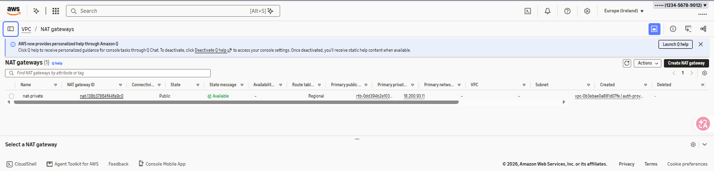

### 8.6 Private route table

VPC → **Route tables** → **Create route table**: name `auth-private`, VPC `auth-provider-vpc`.

- **Routes** → add `0.0.0.0/0` → target **NAT Gateway** → `nat-…`.
- **Subnet associations** → *Explicit subnet associations* → `private-1`, `private-2`.

A subnet **without** an explicit association uses the VPC's main route table (`local` only, no internet), and a Fargate
task there fails to pull its image.

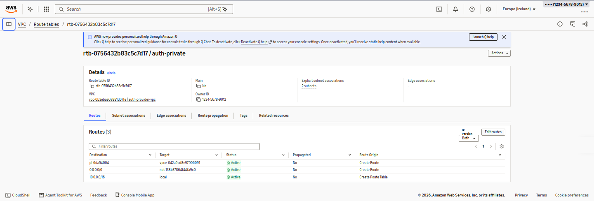

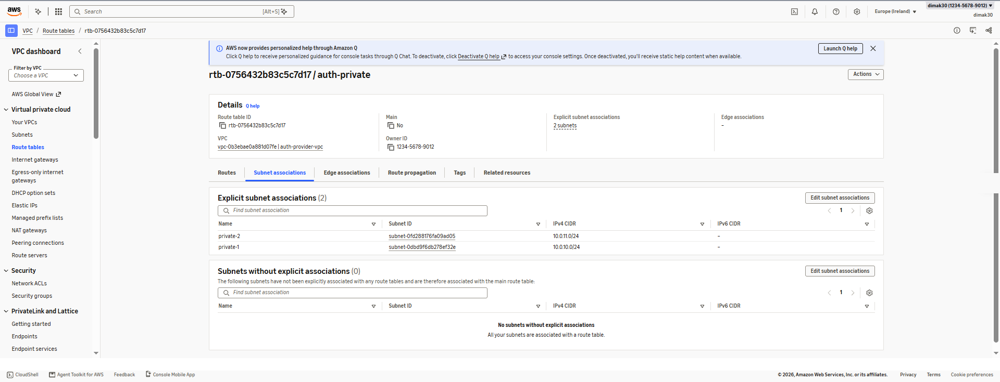

### 8.7 S3 gateway endpoint

VPC → **Endpoints** → **Create endpoint**:

| Field | Value |
|---|---|
| Type | AWS services |
| Service | `com.amazonaws.eu-west-1.s3`, type **Gateway** |
| VPC | `auth-provider-vpc` |
| Route tables | `auth-private` |
| Policy | Full access |

Why: ECR stores image layers in S3, so image pulls go through this free endpoint instead of the NAT (NAT bills per GB).
Only small traffic is left on the NAT: ECR API calls, JWKS, CloudWatch Logs. The endpoint adds a route with the S3
prefix list (`pl-…`) to `auth-private` (visible in the route table screenshot above).

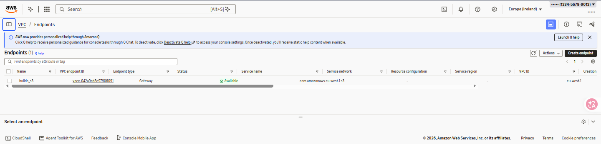

## 9. Security groups

Why: they are the firewall chain **internet → ALB → api → rds**. Create them up front: the wizards (ALB, RDS, ECS
service) would otherwise create unnamed groups open to the world, and a group can only reference a group that already
exists.

EC2 (or VPC) → **Security groups** → **Create security group**, VPC `auth-provider-vpc` for all three:

| Group | Inbound | Source | Used by |
|---|---|---|---|
| `auth-providers-alb` | TCP 80, TCP 443 | `0.0.0.0/0` | ALB |
| `auth-providers-api` | TCP 8000 | security group `auth-providers-alb` | ECS tasks |
| `auth-providers-rds` | TCP 5432 | security group `auth-providers-api` | RDS |

Outbound: default (all traffic). Only the ALB is reachable from the internet; tasks accept traffic only from the ALB,
the database only from the tasks.

**Pitfall:** the *Source* dropdown only lists groups from the VPC selected at the top of the form. If only `default`
shows up, the form is still pointed at the default VPC.

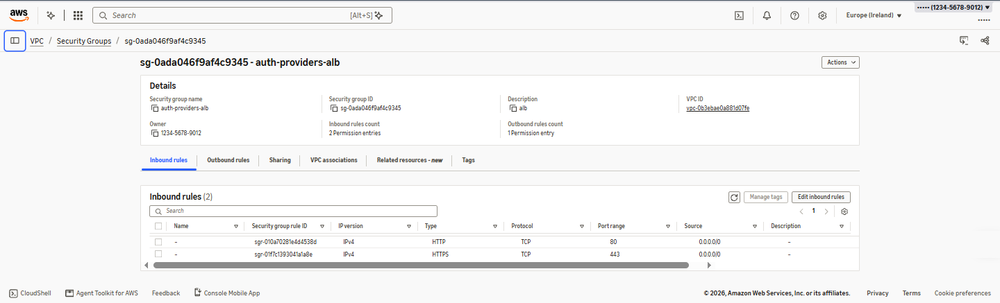

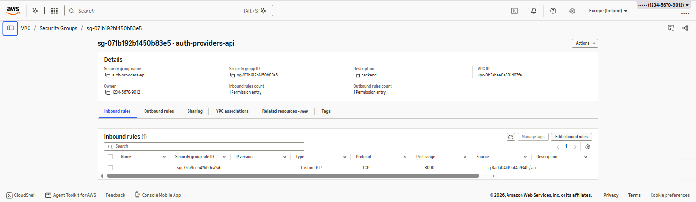


## 10. RDS PostgreSQL

### 10.1 DB subnet group

RDS → **Subnet groups** → **Create DB subnet group**:

| Field | Value |
|---|---|
| Name | `auth-private-db` |
| VPC | `auth-provider-vpc` |
| Availability zones | eu-west-1a, eu-west-1b |
| Subnets | `private-1` (`10.0.10.0/24`), `private-2` (`10.0.11.0/24`) **only** |

Only private subnets, so the database can never get a public route.

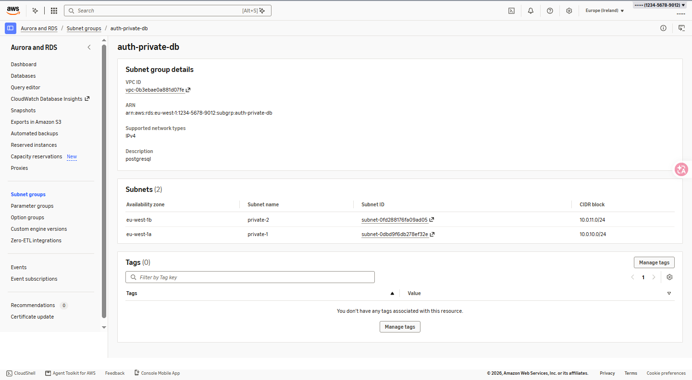

### 10.2 Database

RDS → **Create database** → **Standard create**:

| Section | Field | Value |
|---|---|---|
| Engine | Engine / version | PostgreSQL **18.3** |
| Templates | | **Sandbox** (the console no longer shows "Free tier"; *Production* defaults to Multi-AZ and bigger instances) |
| Settings | DB instance identifier | `auth-provider-db` |
| | Master username | `app` |
| Credentials | Credentials management | **Managed in AWS Secrets Manager** |
| Instance | Class | `db.t4g.micro` |
| Storage | Type / size | gp3, 20 GB |
| Availability | | Single-AZ |
| Connectivity | Compute resource | Don't connect to an EC2 compute resource |
| | VPC | `auth-provider-vpc` |
| | DB subnet group | `auth-private-db` |
| | **Public access** | **No** |
| | VPC security group | existing: `auth-providers-rds` only (remove `default`) |
| | Port | 5432 |
| Additional configuration | Initial database name | `bench` |
| | Encryption | enabled (default KMS key) |

*Managed in AWS Secrets Manager*: RDS generates the master password and keeps it in a secret named `rds!db-…`
(JSON with `username` and `password`), so no password is ever typed, stored or committed by hand.

Result: endpoint `<rds-endpoint>:5432`.

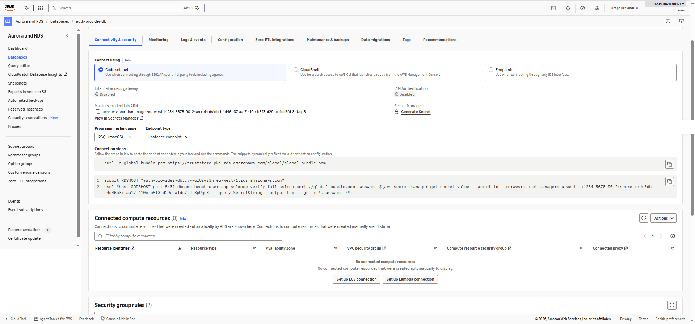

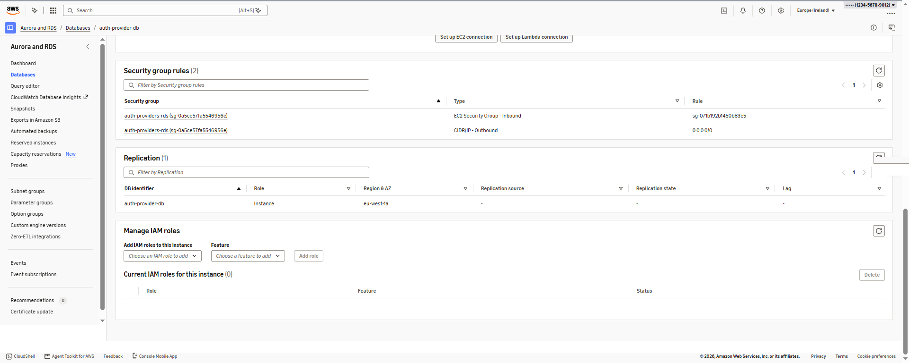

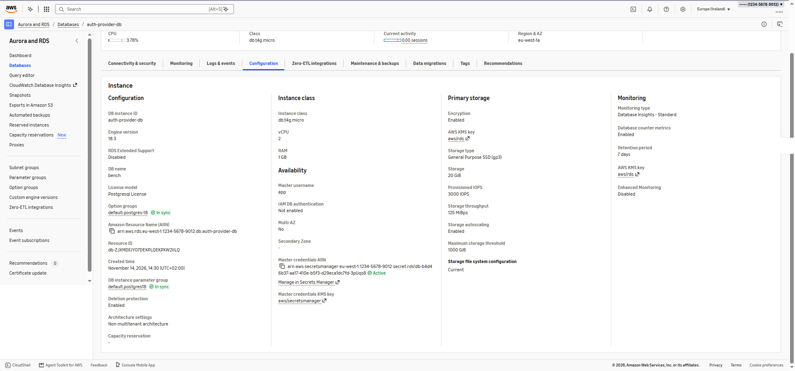

The Sandbox template defaults to backup retention 1 day and deletion protection **off**; both are changed in §21:

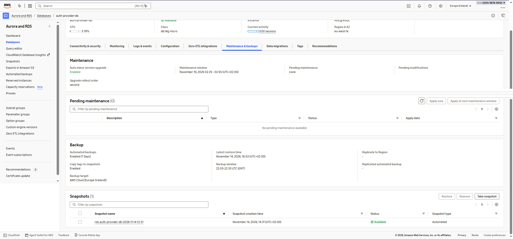

The secret created by RDS (Secrets Manager → Secrets → `rds!db-…`). Don't open *Retrieve secret value* when screen
sharing:

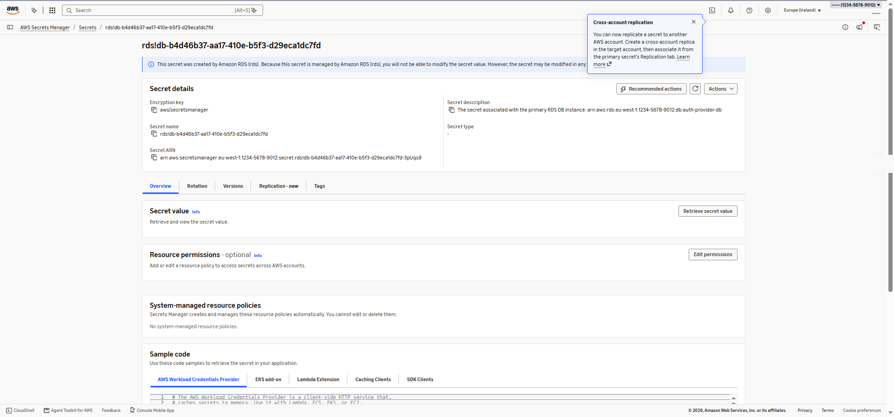

## 11. ECS cluster

ECS → **Clusters** → **Create cluster**:

| Field | Value |
|---|---|
| Cluster name | `auth-providers` |
| Infrastructure | **AWS Fargate (serverless)** only |

Capacity providers `FARGATE` and `FARGATE_SPOT` are attached automatically.

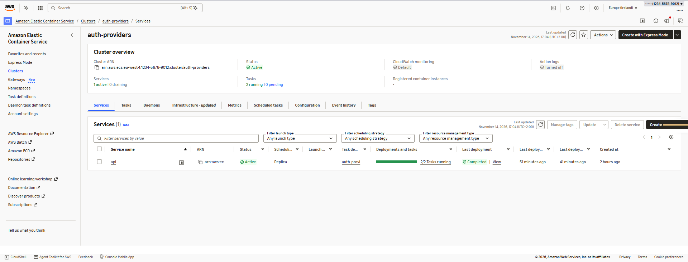

Why Fargate and not EC2: per vCPU/GB Fargate costs ~1.5–2× more (even more against reserved EC2 / Savings Plans), but
there are no instances to patch, scale and pack. EC2 adds an Auto Scaling group with an ECS-optimized AMI, an instance
role, a capacity provider and ENI limits in `awsvpc` mode; task definitions and services stay almost the same.
*Managed Instances* sit in between (EC2 pricing, AWS patches and scales). A cluster can mix capacity providers per
service.

## 12. IAM: task execution role

Why: ECS uses this role **to start** a task: pull the image from ECR, write logs to CloudWatch, read the secrets and
parameters referenced in the task definition. (A *task role* would be for the app's own AWS calls; this app makes none,
so there is no task role.)

1. IAM → **Roles** → **Create role**:
   - Trusted entity type: **AWS service**;
   - Service: **Elastic Container Service** → use case **Elastic Container Service Task**;
   - Permissions: `AmazonECSTaskExecutionRolePolicy`;
   - Role name: `auth-providers-task-execution`.
2. Role → **Add permissions** → **Create inline policy** → JSON → name `read-db-secret`:
   ```json
   {
     "Version": "2012-10-17",
     "Statement": [
       {
         "Effect": "Allow",
         "Action": "secretsmanager:GetSecretValue",
         "Resource": "arn:aws:secretsmanager:eu-west-1:<account-id>:secret:rds!db-…"
       },
       {
         "Effect": "Allow",
         "Action": "logs:CreateLogGroup",
         "Resource": "*"
       },
       {
         "Effect": "Allow",
         "Action": "ssm:GetParameters",
         "Resource": "arn:aws:ssm:eu-west-1:<account-id>:parameter/auth-providers/api/*"
       }
     ]
   }
   ```
   - `secretsmanager:GetSecretValue`: `AmazonECSTaskExecutionRolePolicy` has no Secrets Manager access.
   - `ssm:GetParameters`: added in §13; without it the task fails at start because ECS can't resolve the parameters.
   - `logs:CreateLogGroup`: lets the `awslogs` driver create the log group on the first start (see §21).

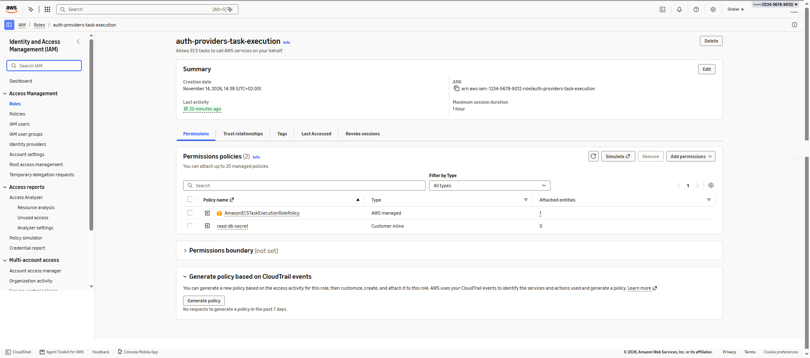

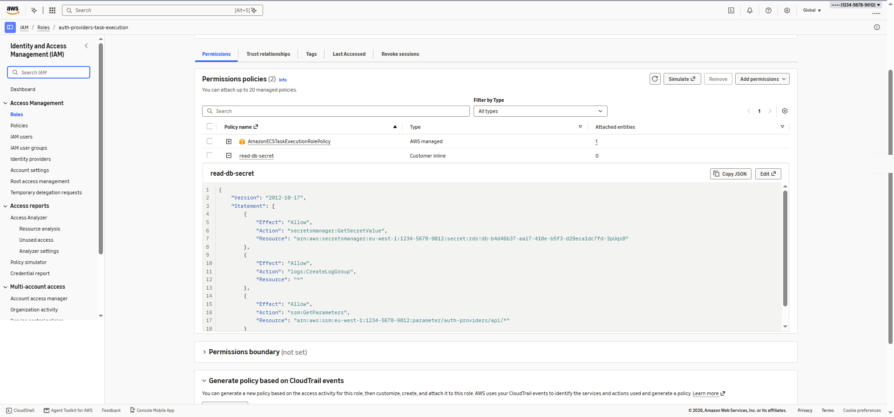

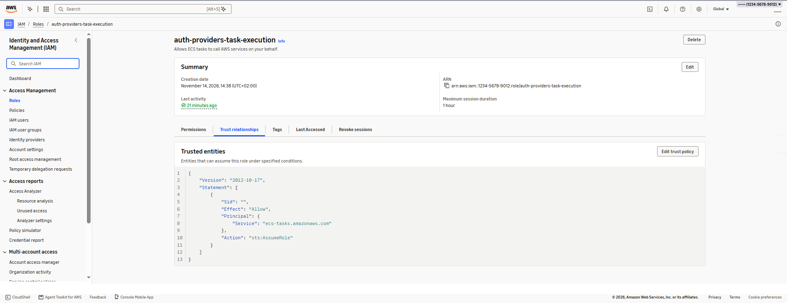

Trust policy (created by the wizard):
```json
{
  "Version": "2012-10-17",
  "Statement": [
    { "Effect": "Allow", "Principal": { "Service": "ecs-tasks.amazonaws.com" }, "Action": "sts:AssumeRole" }
  ]
}
```

## 13. App config: SSM Parameter Store + Secrets Manager

Why: no plain environment variables in the task definition. Non-secret config goes to **SSM Parameter Store** (Standard
tier, type String, free); secrets stay in **Secrets Manager** ($0.40/secret/month — here only the RDS secret).
Plain env vars would need a new task definition revision for every change; with parameters a change only needs
*Update service → Force new deployment* (tasks read the values at start).

Parameters under `/auth-providers/api/` (Supabase values):

| Name | Value |
|---|---|
| `PROVIDER` | `supabase` |
| `POSTGRES_HOST` | `<rds-endpoint>` |
| `POSTGRES_PORT` | `5432` |
| `POSTGRES_DB` | `bench` |
| `AUTH_DOMAIN` | `<ref>.supabase.co` |
| `ISSUER` | `https://<ref>.supabase.co/auth/v1` |
| `ISSUER_PATH` | `/.well-known/jwks.json` |
| `API_AUDIENCE` | `authenticated` |
| `ALGORITHMS` | `["ES256"]` |
| `CORS_ORIGINS` | `["https://app.dimak-auth.xyz"]` (added in §20) |

Created in one go (PowerShell):
```powershell
$p = @{ PROVIDER="supabase"; POSTGRES_HOST="<rds-endpoint>"; POSTGRES_PORT="5432"; POSTGRES_DB="bench"
        AUTH_DOMAIN="<ref>.supabase.co"; ISSUER="https://<ref>.supabase.co/auth/v1"
        ISSUER_PATH="/.well-known/jwks.json"; API_AUDIENCE="authenticated"; ALGORITHMS='["ES256"]' }
$p.GetEnumerator() | % {
  aws ssm put-parameter --profile dev --region eu-west-1 `
    --name "/auth-providers/api/$($_.Key)" --type String --value $_.Value --overwrite
}
```

- **Pitfall (Git Bash):** paths like `/auth-providers/api` get rewritten into Windows paths; prefix the command with
  `MSYS_NO_PATHCONV=1`.
- **Pitfall (quotes):** JSON values (`ALGORITHMS`, `CORS_ORIGINS`) must be stored without surrounding single quotes.
  When the command runs in a shell that doesn't strip them, the stored value becomes `'[...]'` (invalid JSON) — check
  it in the console and fix it there.
- `POSTGRES_USER` / `POSTGRES_PASSWORD` are **not** parameters: they come straight from the RDS secret (§14).

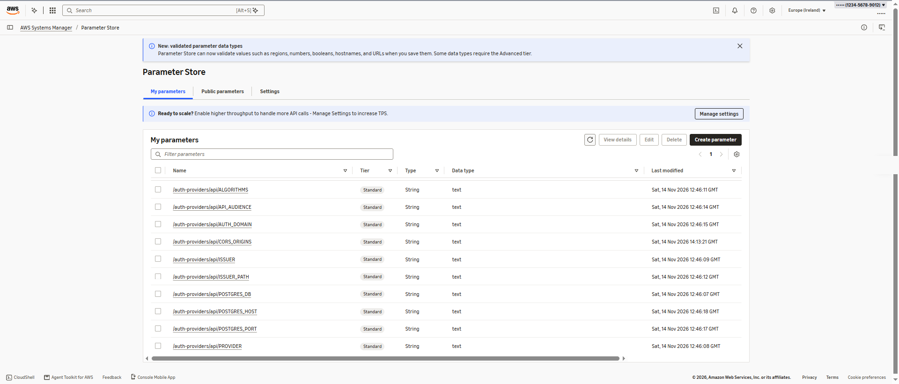

## 14. Task definition

ECS → **Task definitions** → **Create new task definition**:

| Section | Field | Value |
|---|---|---|
| Family | | `auth-providers-api` |
| Infrastructure | Launch type | **AWS Fargate** |
| | OS / architecture | Linux/X86_64 |
| | Network mode | `awsvpc` (the only option on Fargate) |
| | Task size | **0.5 vCPU / 1 GB** |
| Roles | Task role | none (the app calls no AWS APIs) |
| | Task execution role | `auth-providers-task-execution` |
| Container 1 | Name | `api` |
| | Image URI | `<account-id>.dkr.ecr.eu-west-1.amazonaws.com/auth-providers-api:<git-sha>` (the console pins it by digest `@sha256:…`) |
| | Essential | yes |
| | Port mapping | container port **8000**, TCP, app protocol HTTP |
| Environment | Environment variables | all **ValueFrom**, see below |
| Logging | Log collection | on, `awslogs` |
| | `awslogs-group` | `/ecs/auth-providers-api` |
| | `awslogs-region` | `eu-west-1` |
| | `awslogs-stream-prefix` | `ecs` |
| | `awslogs-create-group` | `true` |

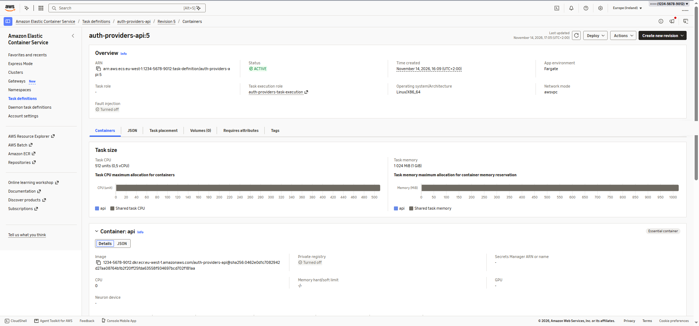

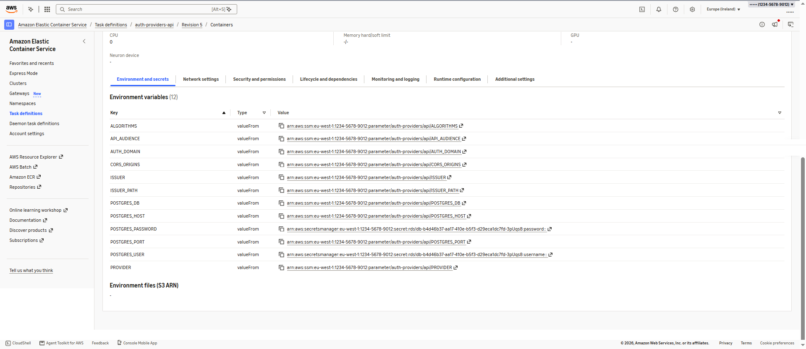

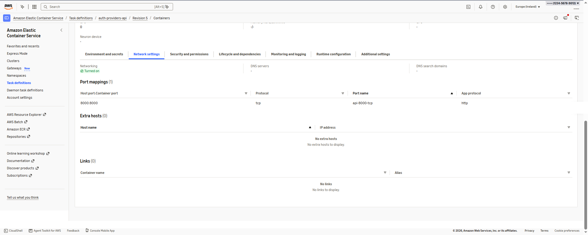

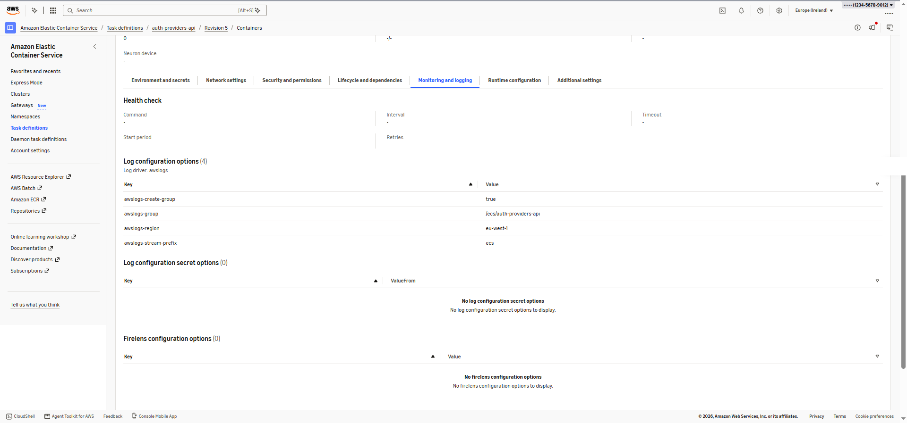

Environment variables — all 12 are **ValueFrom** (they end up in the container's `secrets` block, none in plain
`environment`):

| Key | ValueFrom |
|---|---|
| `ALGORITHMS`, `API_AUDIENCE`, `AUTH_DOMAIN`, `CORS_ORIGINS`, `ISSUER`, `ISSUER_PATH`, `POSTGRES_DB`, `POSTGRES_HOST`, `POSTGRES_PORT`, `PROVIDER` | `arn:aws:ssm:eu-west-1:<account-id>:parameter/auth-providers/api/<NAME>` |
| `POSTGRES_USER` | `arn:aws:secretsmanager:eu-west-1:<account-id>:secret:rds!db-…:username::` |
| `POSTGRES_PASSWORD` | `arn:aws:secretsmanager:eu-west-1:<account-id>:secret:rds!db-…:password::` |

The `:username::` / `:password::` suffix picks one JSON key out of the RDS secret
(format `<secret-arn>:<json-key>:<version-stage>:<version-id>`, the last two empty = current version).

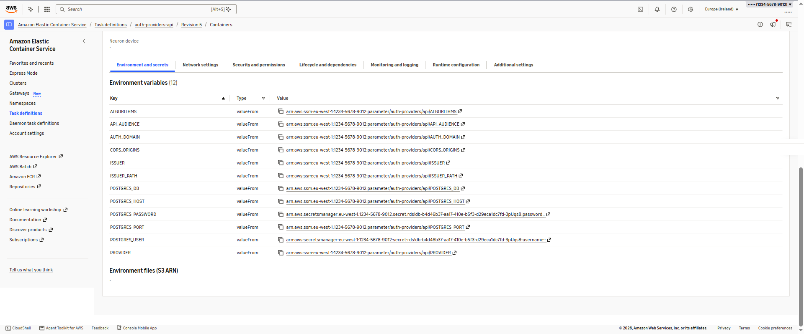

## 15. Target group

Load balancers live in the **EC2 console** for historical reasons; they don't depend on EC2 instances.

EC2 → **Target groups** → **Create target group**:

| Field | Value |
|---|---|
| Target type | **IP addresses** (required for Fargate / `awsvpc`) |
| Name | `auth-providers-api` |
| Protocol : port | HTTP : 8000 |
| IP address type | IPv4 |
| VPC | `auth-provider-vpc` |
| Protocol version | HTTP1 |
| Health check | HTTP, path **`/healthz`**, success codes `200` |

**Register targets:** none. The ECS service registers and deregisters task IPs by itself.

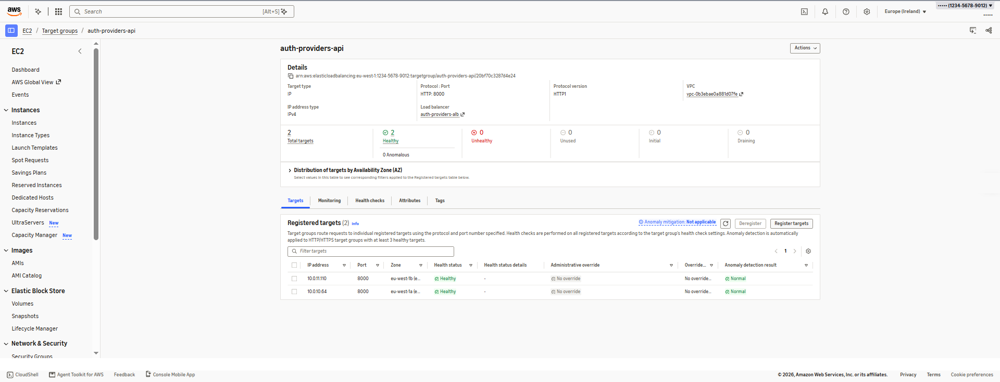

After the service is running (§18), the targets are the task IPs in the private subnets:

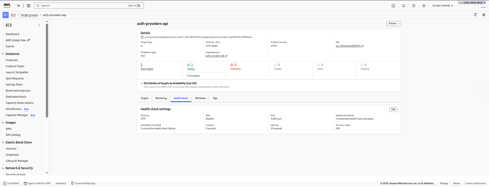

## 16. Application Load Balancer

EC2 → **Load balancers** → **Create load balancer** → **Application Load Balancer**:

| Section | Field | Value |
|---|---|---|
| Basic | Name | `auth-providers-alb` |
| | Scheme | **Internet-facing** |
| | IP address type | IPv4 |
| Network mapping | VPC | `auth-provider-vpc` |
| | Mappings | eu-west-1a → `public-1`, eu-west-1b → `public-2` |
| Security groups | | `auth-providers-alb` only (remove `default`) |
| Listener 1 | HTTPS : **443** | default action **Forward to** target group `auth-providers-api` |
| | Secure listener settings | certificate from ACM: `dimak-auth.xyz` (+ wildcard) |
| | Security policy | console default `ELBSecurityPolicy-TLS13-1-2-Res-PQ-2025-09` |
| Listener 2 | HTTP : **80** | default action **Redirect to URL**: protocol HTTPS, port 443, status `HTTP_301` (host, path, query kept) |

Result: DNS name `auth-providers-alb-<id>.eu-west-1.elb.amazonaws.com`.

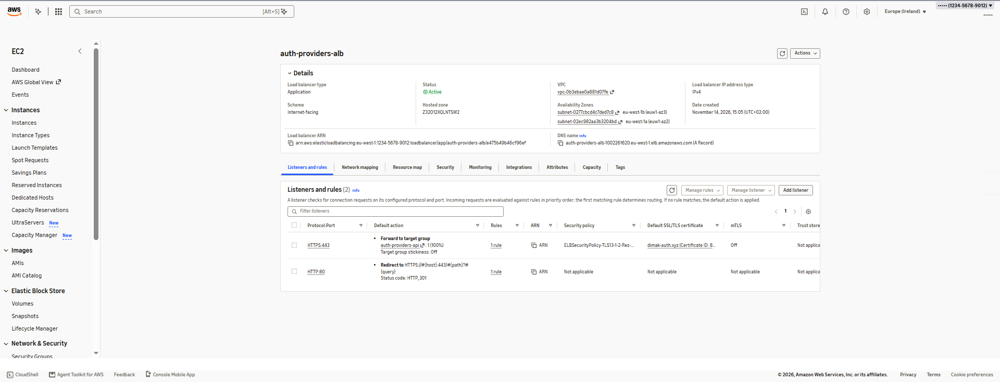

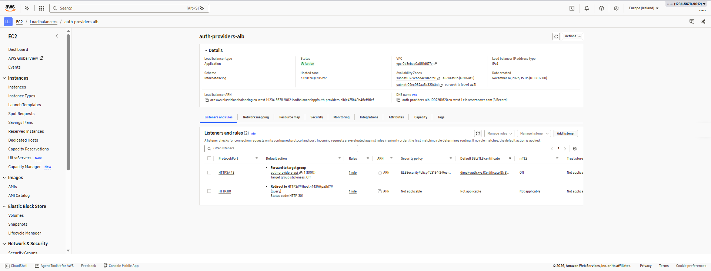

Note: an ALB can also validate JWTs in the listener (signature via JWKS, `iss`, `exp`) before forwarding. Not enabled
here: the backend validates tokens anyway and needs the claims; it would only be an extra layer.

## 17. DNS record for the API

Route 53 → hosted zone `dimak-auth.xyz` → **Create record**:

| Field | Value |
|---|---|
| Record name | `api` |
| Record type | **A** |
| Alias | **on** |
| Route traffic to | Alias to Application and Classic Load Balancer → eu-west-1 → `dualstack.auth-providers-alb-…` |
| Routing policy | Simple |
| Evaluate target health | Yes |

An alias record follows the ALB's changing IPs (a plain A record with an IP wouldn't, and a CNAME isn't allowed at the
zone apex). Alias records have no TTL and no query cost.

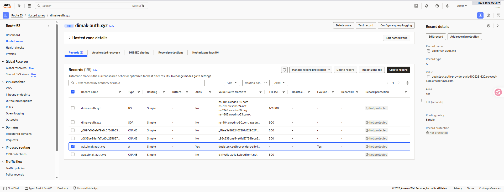

## 18. ECS service

ECS → cluster `auth-providers` → **Services** → **Create**:

| Section | Field | Value |
|---|---|---|
| Compute | Compute options | **Capacity provider strategy** |
| | Strategy | `FARGATE_SPOT` (see note) |
| Deployment configuration | Family / revision | `auth-providers-api`, latest |
| | Service name | `api` |
| | Desired tasks | **2** |
| | Deployment type | Rolling update |
| | Deployment failure detection | **Use the Amazon ECS deployment circuit breaker** + **Rollback on failures** |
| Networking | VPC | `auth-provider-vpc` |
| | Subnets | `private-1`, `private-2` only |
| | Security group | existing `auth-providers-api` only |
| | **Public IP** | **off** |
| Load balancing | Type | Application Load Balancer, **use an existing load balancer** `auth-providers-alb` |
| | Container to load balance | `api 8000:8000` |
| | Listener | **existing** 443:HTTPS |
| | Target group | **existing** `auth-providers-api` |

- `FARGATE_SPOT` is ~70% cheaper; AWS may reclaim a task with a 2-minute notice. For production mix it, e.g.
  `FARGATE` base 1 weight 1 + `FARGATE_SPOT` base 0 weight 1.
- Public IP off: the tasks reach the internet through the NAT; nothing can connect to them except the ALB.
- Circuit breaker: if new tasks keep failing, ECS stops the deployment and rolls back to the last working revision.

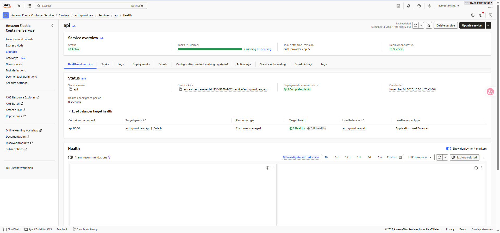

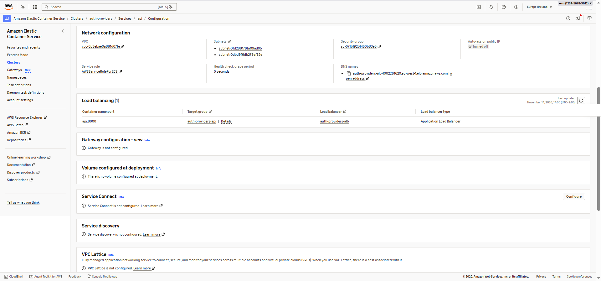

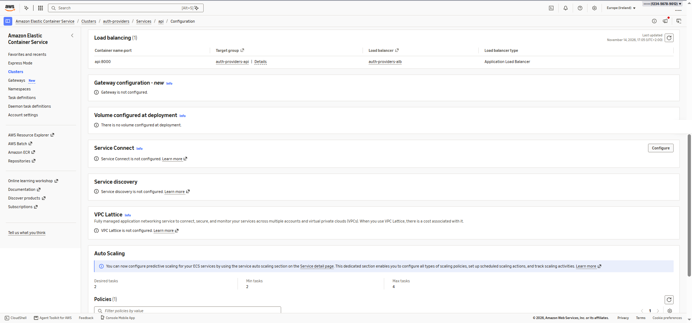

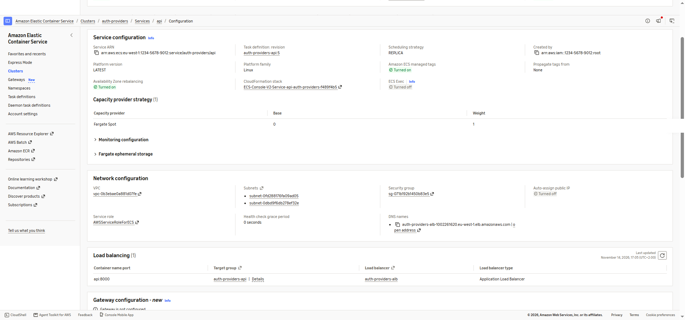

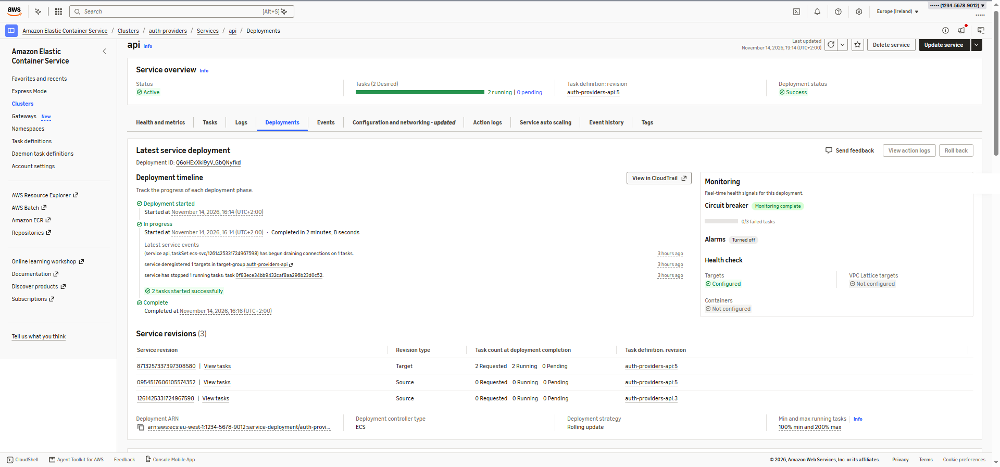

### 18.1 First start failed: Alembic and `%` in the DB password

Tasks exited with code 1 during `alembic upgrade head`:
```
ValueError: invalid interpolation syntax in 'postgresql+asyncpg://app:…%3F…' at position 28
```
The RDS-generated password contains special characters, `quote_plus` encodes them as `%XX`, and
`config.set_main_option()` goes through `configparser`, which treats `%` as interpolation syntax.
Fix in `migrations/env.py`:
```python
config.set_main_option("sqlalchemy.url", settings.DATABASE_URL.replace("%", "%%"))
```
Side effect: the exception message printed the full connection string, so the password ended up in CloudWatch Logs.
Remediation options: rotate the RDS secret (Secrets Manager → **Rotate secret immediately**) and delete the affected log
streams. Lesson: never let a DSN with a password reach an exception or a log line.

### 18.2 Deploying a fixed image

1. Build and push a new image with a new tag (git SHA of the fix commit), see §7.3.
2. Task definition `auth-providers-api` → **Create new revision** → container `api` → **change the Image URI** to the new
   tag → Create.
3. Service `api` → **Update service** → revision = the new one → Update.

ECS doesn't follow tags: a task definition points at one exact image.
**Pitfall:** *Create new revision* keeps the old image (pinned by digest) unless the Image URI is changed — revision 2
still ran the broken image. Revision 3 with `:c1a274c` deployed fine (`COMPLETED`, 2/2 running).

Rolling update: ECS starts the new tasks, waits for the ALB to mark them healthy, then stops the old ones (4 tasks for a
moment). Container *Health status: Unknown* is expected: health is checked by the ALB, not by a container health check.

Later split of responsibilities: Terraform creates the service and the first task definition with
`lifecycle { ignore_changes = [task_definition] }`; GitHub Actions registers new revisions and updates the service on
every push.

## 19. Frontend on AWS Amplify

1. Amplify → **Create new app** → **GitHub** → install the GitHub App once (grant only this repository; private repos
   work). Every push to `main` then triggers a build automatically, no re-authorization needed.
2. Repository `<github-user>/Auth-providers`, branch `main`, check **My app is a monorepo** → root directory
   `frontend`.
3. Build settings are auto-detected (`npm ci`, `npm run build`, output `dist`, `appRoot: frontend`).
4. **Environment variables** (Vite bakes `VITE_*` into the bundle **at build time**, so changing one needs a rebuild:
   *Redeploy this version*; `.env.local` is not in the repo):

   | Variable | Value |
   |---|---|
   | `VITE_API_URL` | `https://api.dimak-auth.xyz` |
   | `VITE_DEFAULT_PROVIDER` | `supabase` |
   | `VITE_SUPABASE_URL` | `https://<ref>.supabase.co` |
   | `VITE_SUPABASE_KEY` | Supabase **publishable** key (`sb_publishable_…`) |

   Auth0 / Keycloak variables are left out: the backend on ECS only trusts Supabase, and providers without variables are
   disabled in the provider switcher.
5. Save and deploy. Result: `https://main.<app-id>.amplifyapp.com`.

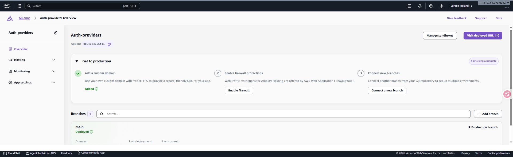

Build specification (Hosting → Build settings), as auto-detected:
```yaml
version: 1
applications:
  - frontend:
      phases:
        preBuild:
          commands:
            - npm ci --cache .npm --prefer-offline
        build:
          commands:
            - npm run build
      artifacts:
        baseDirectory: dist
        files:
          - '**/*'
      cache:
        paths:
          - .npm/**/*
    appRoot: frontend
```

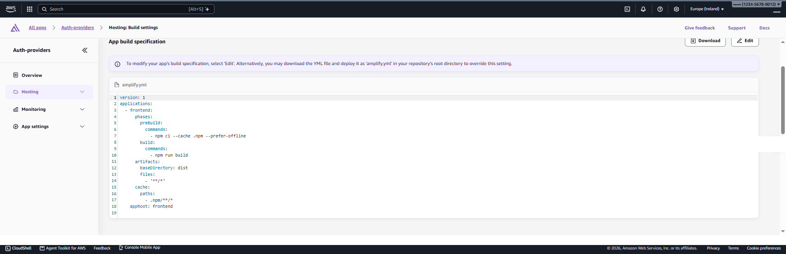

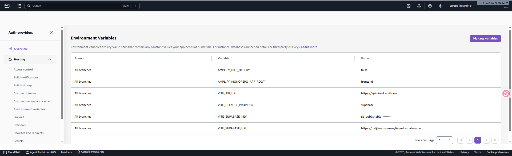

### 19.1 Custom domain

Amplify → Hosting → **Custom domains** → **Add domain** → `dimak-auth.xyz` (the Route 53 zone is detected) →
**Configure domain**: keep only the subdomain `app` → branch `main` (remove the root/`www` mappings) → Add domain.

Amplify issues its own certificate and creates the Route 53 records itself (the validation CNAME and
`app` → CloudFront). After a few minutes the domain status is **Available**, SSL certificate *Amplify managed*.

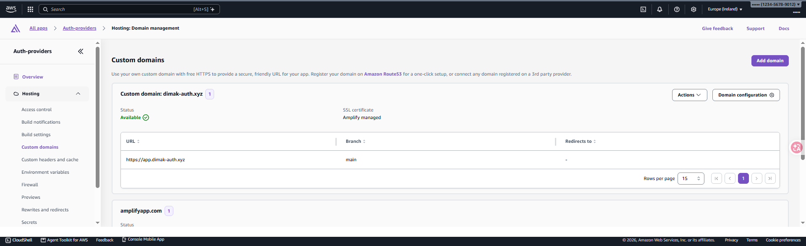

## 20. Wiring frontend and backend together

### 20.1 Supabase redirect URLs

Supabase → Authentication → **URL Configuration**:
- **Site URL**: `https://app.dimak-auth.xyz`;
- **Redirect URLs** → Add URL: `https://app.dimak-auth.xyz` (and the `amplifyapp.com` URL if it is used).

Without it Supabase falls back to the Site URL, which was `http://localhost:5173`, so Google login bounced to
localhost. Google Cloud Console needs no change: Google returns to the Supabase callback, which didn't change.

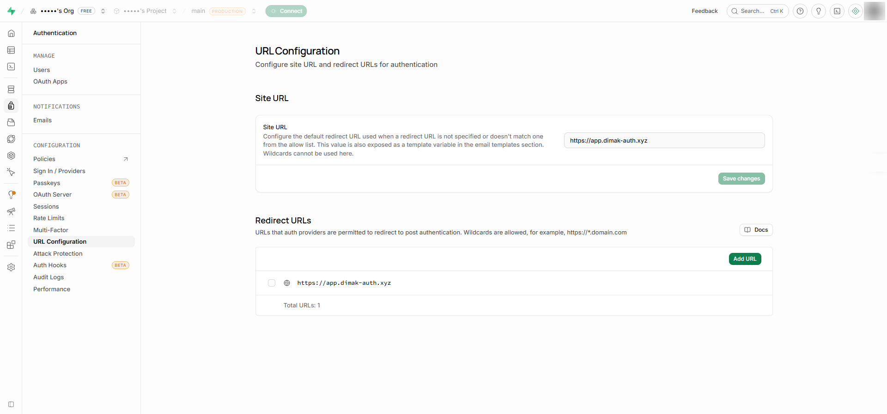

### 20.2 Backend CORS

1. New backend setting `CORS_ORIGINS: list` (read from env, JSON like `ALGORITHMS`).
2. SSM parameter `/auth-providers/api/CORS_ORIGINS` = `["https://app.dimak-auth.xyz"]` (see the quoting pitfall in §13).
3. Task definition → new revision → add `CORS_ORIGINS` as **ValueFrom** → the parameter ARN.
4. Service `api` → Update service → the new revision.

Parameters are read only at task start, so any parameter change needs new tasks (a new revision, or
*Force new deployment* if the variable list is unchanged).

## 21. Production hardening

### 21.1 Log retention

CloudWatch → **Log groups** → `/ecs/auth-providers-api` → Actions → **Edit retention setting** → **1 month**
(default is *Never expire*).

The group was never created by hand: the console put `awslogs-group = /ecs/<family>` and `awslogs-create-group = true`
into the task definition, and ECS created it on the first task start (allowed by `logs:CreateLogGroup`).
In Terraform: create it explicitly with `retention_in_days` and drop `logs:CreateLogGroup` from the role.

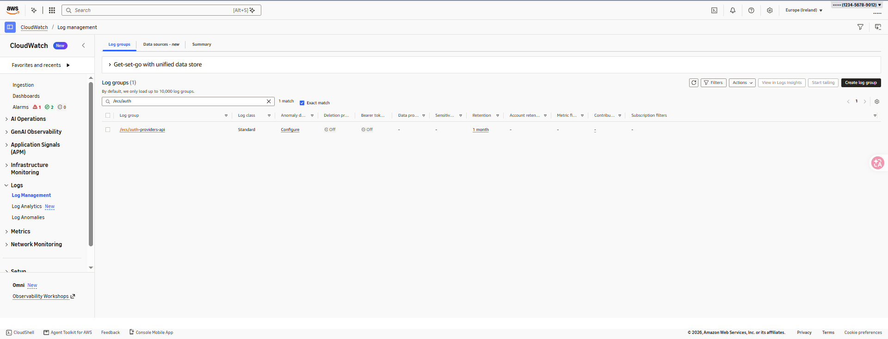

### 21.2 Service auto scaling

ECS → service `api` → **Update service** → **Service auto scaling** → Use service auto scaling:

| Field | Value |
|---|---|
| Minimum tasks | 2 |
| Maximum tasks | 4 |
| Policy type | Target tracking |
| Policy name | `cpu-60` |
| Metric | `ECSServiceAverageCPUUtilization` |
| Target value | 60 |

In Terraform: `aws_appautoscaling_target` + `aws_appautoscaling_policy`, and `ignore_changes = [desired_count]` on the
service so Terraform doesn't fight the scaler.

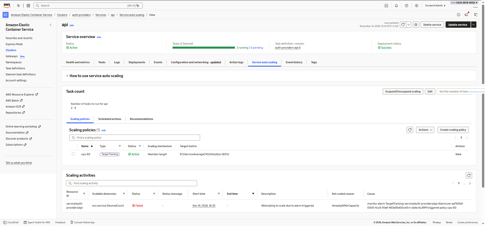

### 21.3 Alerts channel (SNS)

SNS → **Topics** → **Create topic** → type **Standard**, name `auth-providers-alerts` →
**Create subscription** → protocol **Email** → your address. Confirm via the link in the AWS email; until then the
subscription stays `PendingConfirmation` and nothing is delivered.

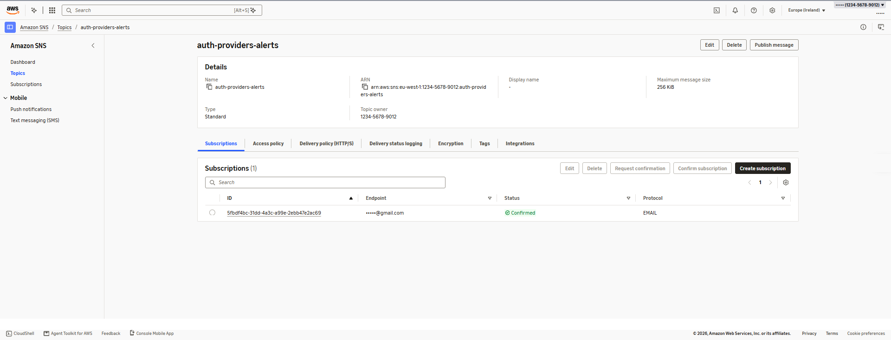

### 21.4 RDS backups and deletion protection

RDS → `auth-provider-db` → **Modify**:
- Backup retention period: **7 days**;
- **Enable deletion protection**;
- Apply **immediately**.

Point-in-time restore is possible to any second within the window (`LatestRestorableTime` is ~5 minutes behind) and
always goes into a **new** instance. Deletion protection must be turned off before tearing the stack down (e.g. for the
Terraform rebuild test). Screenshot: see §10.2 (*Maintenance & backups*).

### 21.5 5xx alarm

CloudWatch → **Alarms** → **Create alarm** → Select metric → **ApplicationELB** → **Per AppELB Metrics** →
`auth-providers-alb` → **`HTTPCode_Target_5XX_Count`**:

| Field | Value |
|---|---|
| Statistic | Sum |
| Period | 5 minutes |
| Condition | Greater than **5** |
| Missing data treatment | Treat missing data as **not breaching** |
| Notification | In alarm → SNS topic `auth-providers-alerts` |
| Name | `api-5xx` |

- `INSUFFICIENT_DATA` right after creation is normal: the metric only exists once a 5xx happens.
- **Pitfall:** `HTTPCode_ELB_5XX_Count` counts errors generated by the ALB itself (e.g. no healthy targets). 500s
  returned by the app are `HTTPCode_Target_5XX_Count`; with the ELB metric they never trigger the alarm.
- Test: requests with a garbage bearer token returned **500** — a real bug: the app had no exception handler for
  `InvalidTokenException` (should be 401) / `InsufficientScopeException` (403). The email
  "ALARM: api-5xx … Threshold Crossed: [10.0] > 5.0" arrived ~10 minutes after the requests (the alarm waits for the
  5-minute period to close).
- Only the ALARM action is set. Adding the same topic as the OK action also sends a "recovered" email.


## 22. Cache (Valkey) and media storage (S3)

Two additions to the running stack: a **Valkey** cache (ElastiCache Serverless, the Redis-compatible engine that AWS
now recommends and prices lower than Redis OSS) for the order list, and an **S3 bucket** for order photos that the
browser uploads and loads directly through presigned URLs. Both are production-style: the cache is private, encrypted
in transit and password-protected; the bucket is private, encrypted and reachable only through signed links.

```
ECS task (SG auth-providers-api) ──6379/6380, TLS, user "app"──► Valkey Serverless (private subnets, SG auth-providers-redis)
ECS task (task role auth-providers-task) ──S3 API via the S3 gateway endpoint──► bucket auth-providers-media-<account-id>
Browser ──presigned PUT / GET (CORS)──► bucket auth-providers-media-<account-id>
```

### 22.1 Security group for the cache

EC2 → **Security groups** → **Create security group**, VPC `auth-provider-vpc`:

| Field | Value |
|---|---|
| Name | `auth-providers-redis` |
| Description | `Valkey: 6379/6380 from the ECS tasks` |
| Inbound | Custom TCP **6379**, source security group `auth-providers-api` |
| Inbound | Custom TCP **6380**, source security group `auth-providers-api` |
| Outbound | default (all) |

A serverless cache has two endpoints: **6379** (primary, reads and writes) and **6380** (reader endpoint, reads from
replicas). Only the API tasks may connect.


### 22.2 Password in Secrets Manager

The app user's password is generated, never typed, and handed to the task through Secrets Manager (like the RDS
password).

1. Generate a password without the characters ElastiCache doesn't allow (`,` `"` `/` `@` and spaces):
   ```powershell
   aws secretsmanager get-random-password --password-length 32 --exclude-characters ',"/@ ' --profile dev --query RandomPassword --output text
   ```
2. Secrets Manager → **Store a new secret** → **Other type of secret** → **Plaintext** → paste the password →
   name `auth-providers/redis-password` → no rotation → Store.

The secret is a plain string, not JSON, so the task definition references the whole secret ARN without a
`:key::` suffix. Do not open *Retrieve secret value* when screen sharing.


### 22.3 ElastiCache user and user group

Valkey with a user group enforces authentication (RBAC): only listed users with their passwords can connect.

1. ElastiCache → **User management** → **Create user**:

   | Field | Value |
   |---|---|
   | User ID | `auth-providers-app` |
   | User name | `app` (what the client sends) |
   | Engine | Valkey |
   | Access string | `on ~* +@all` (enabled, all keys, all commands) |
   | Authentication mode | Password → the password from §22.2 |

2. ElastiCache → **User group management** → **Create user group**: ID `auth-providers`, engine **Valkey**, add the
   user `auth-providers-app`.

For the Redis OSS engine a group must contain a user named `default`, so people add a disabled one
(`off -@all`). For **Valkey** the group was created with only the `app` user, so no anonymous `default` access exists.


### 22.4 Valkey Serverless cache

ElastiCache → **Valkey caches** → **Create Valkey cache** → **Serverless** → **Customize default settings**:

| Section | Field | Value |
|---|---|---|
| Settings | Name | `auth-providers` |
| | Engine version | 8 (major; minor upgrades are automatic) |
| Connectivity | VPC | `auth-provider-vpc` |
| | Subnets | `private-1`, `private-2` |
| | Security groups | `auth-providers-redis` only (remove `default`) |
| Security | Encryption in transit | always on for serverless (TLS, cannot be disabled) |
| | Encryption at rest | AWS owned key |
| | Access control | **User group access control list** → `auth-providers` |
| Usage limits | Maximum data storage | **1 GB** |
| | Maximum ECPU per second | **5 000** |
| Backups | Daily automatic backups | on, start **03:00 UTC**, retention **1** day |

- Serverless replicates across AZs by itself; there are no nodes to size.
- The usage limits are the cost ceiling: at the limit requests slow down instead of the bill growing.
- Result: endpoint `auth-providers-<id>.serverless.euw1.cache.amazonaws.com:6379`.


**Client side.** A serverless cache works in cluster mode and requires TLS, so the app uses a cluster-aware client
with SSL and the user/password passed separately (never inside a URL: a generated password would need URL-encoding,
the same trap as `%` in the database password in §18.1):

```python
from redis.asyncio.cluster import RedisCluster

RedisCluster(host=s.HOST, port=s.PORT, username=s.USERNAME, password=s.PASSWORD,
             ssl=True, decode_responses=True, socket_connect_timeout=2, socket_timeout=2)
```

Locally (docker-compose, plain Valkey without TLS and auth) the same settings switch to a regular `Redis` client with
`REDIS__CLUSTER=false`, `REDIS__SSL=false`.

### 22.5 Media bucket

S3 → **Create bucket**, region eu-west-1:

| Field | Value |
|---|---|
| Bucket name | `auth-providers-media-<account-id>` (globally unique) |
| Object Ownership | ACLs disabled |
| Block Public Access | **Block all public access** |
| Versioning | disabled |
| Default encryption | SSE-S3 |


**CORS** (Permissions → Cross-origin resource sharing → Edit). The browser talks to S3 directly (presigned PUT for the
upload, GET for ``), so the bucket must allow the frontend origin:

```json
[
  {
    "AllowedHeaders": ["*"],
    "AllowedMethods": ["GET", "HEAD", "PUT"],
    "AllowedOrigins": ["https://app.dimak-auth.xyz"],
    "ExposeHeaders": ["ETag"],
    "MaxAgeSeconds": 3000
  }
]
```


**Lifecycle rule** (Management → Create lifecycle rule): name `expire-unattached-uploads`, prefix **`tmp/`**, expire
current versions after **1 day**. It is meant for uploads that were never attached to an order (upload to `tmp/`,
copy to a permanent prefix when the order is created). The app currently stores photos under `uploads/`, which the
rule does not touch.


### 22.6 Task role for S3

The **execution role** (§12) is used by ECS to *start* the task. Code *inside* the container (boto3) needs its own
**task role**. Without one, boto3 has no credentials at all; with it, boto3 picks up short-lived keys automatically
and nothing is stored in environment variables.

IAM → **Roles** → **Create role** → AWS service → Elastic Container Service → **Elastic Container Service Task** →
no managed policies → name `auth-providers-task` → then **Add permissions** → **Create inline policy** (JSON):

```json
{
  "Version": "2012-10-17",
  "Statement": [
    {
      "Sid": "Objects",
      "Effect": "Allow",
      "Action": ["s3:PutObject", "s3:GetObject", "s3:DeleteObject"],
      "Resource": "arn:aws:s3:::auth-providers-media-<account-id>/*"
    },
    {
      "Sid": "List",
      "Effect": "Allow",
      "Action": "s3:ListBucket",
      "Resource": "arn:aws:s3:::auth-providers-media-<account-id>"
    }
  ]
}
```

- Object actions apply to `bucket/*`, `ListBucket` to the bucket itself: two different resources, two statements.
- A presigned URL works only if the signer may do the action itself: `PutObject` / `GetObject` are needed for the
  links handed to the browser.
- `s3:ListBucket` matters for `head_object`: without it a missing key returns **403** instead of **404**, and the
  app can't tell "not uploaded yet" from "access denied".


(The role on the screenshot is named `auth-provers-task` — a typo in the first apply; the guide uses
`auth-providers-task`.)

### 22.7 Config and the task definition

New SSM parameters under `/auth-providers/api/` (String):

| Name | Value |
|---|---|
| `REDIS__HOST` | the cache endpoint host (without `:6379`) |
| `REDIS__PORT` | `6379` |
| `REDIS__SSL` | `true` |
| `REDIS__CLUSTER` | `true` |
| `REDIS__USERNAME` | `app` |
| `S3__BUCKET` | `auth-providers-media-<account-id>` |
| `S3__REGION` | `eu-west-1` |

The double underscore is pydantic-settings' nested delimiter: `REDIS__HOST` fills `settings.REDIS.HOST`.
`S3__ENDPOINT_URL`, `S3__PUBLIC_ENDPOINT_URL` and S3 keys are **not** set in AWS: they exist only for the local
S3-compatible storage.

Permissions for the execution role (§12, inline policy): add the Redis secret ARN to the
`secretsmanager:GetSecretValue` statement; the new parameters are covered by `parameter/auth-providers/api/*`.

Task definition → **Create new revision**:
- **Task role:** `auth-providers-task`;
- container `api` → Environment variables → add the seven parameters above as **ValueFrom** (SSM ARNs) and
  `REDIS__PASSWORD` as **ValueFrom** = the secret ARN `arn:aws:secretsmanager:…:secret:auth-providers/redis-password-…`.


Then update the service to the new revision. The GitHub deploy role (CI registers revisions) now also needs
`iam:PassRole` on the task role, otherwise `RegisterTaskDefinition` fails.

### 22.8 How the app uses them

- **Order list cache** (`orders:<user_id>`, 60 s, probabilistic early refresh "XFetch"): stored as JSON; the cache is
  dropped when an order is created. If the cache is unavailable, the service falls back to the database.
- **Photo upload in one form:**
  1. as soon as a file is picked, the frontend calls `POST /api/v1/orders/uploads` with `{"content_type": "image/webp"}`;
     the API answers with a presigned PUT URL and the key `uploads/<user-id>/<uuid>.webp`;
  2. the browser PUTs the file straight to S3 (same `Content-Type` as signed, otherwise 403);
  3. `POST /api/v1/orders` carries the key; the API checks the key prefix belongs to the user and that the object
     exists (`head_object`), then stores only the **key** in the database;
  4. order responses carry `photo_url` — a presigned GET generated on every read (links expire, keys don't).
- **Regional endpoint for presigned URLs:** boto3 must sign for `https://<bucket>.s3.eu-west-1.amazonaws.com`. A URL
  for the global host `<bucket>.s3.amazonaws.com` gets **307 Temporary Redirect** for a new bucket outside us-east-1,
  and browsers don't follow redirects in CORS requests — it shows up as a CORS error.
- `/readyz` pings both the database and the cache; the ALB health check stays on the shallow `/healthz`.


## 23. Verification

From outside:

```powershell
curl.exe -i https://api.dimak-auth.xyz/healthz          # 200 {"status":"ok"}
curl.exe -i https://api.dimak-auth.xyz/readyz           # 200 (DB and cache reachable, migrations ran)
curl.exe -i http://api.dimak-auth.xyz/healthz           # 301 → https://
curl.exe -i https://api.dimak-auth.xyz/api/v1/users/me  # 401 without a token
```


`https://app.dimak-auth.xyz` → sign in with Supabase (Google) → orders can be created and listed:


### Request path: api.dimak-auth.xyz → container

1. Route 53 alias record `api` → ALB DNS name.
2. ALB (public subnets, SG `auth-providers-alb`) → listener **443** terminates TLS with the ACM certificate.
3. Listener default action → forward to target group `auth-providers-api` (type IP, HTTP:8000, health check `/healthz`).
4. ECS service `api` (load balancer block: container `api`, port 8000) registers each task's IP in the target group.
5. Task ENI in a private subnet with SG `auth-providers-api` (allows 8000 only from the ALB SG) → container port 8000.
6. Container → RDS on 5432 (SG `auth-providers-rds` allows only the api SG) and Valkey on 6379 over TLS
   (SG `auth-providers-redis`); outbound to the internet (JWKS) via the NAT; image layers and the media bucket via
   the S3 gateway endpoint.

## 24. Costs and pausing overnight

| Free | Paid |
|---|---|
| VPC, subnets, IGW, route tables, security groups, S3 gateway endpoint, ACM certificate, SSM Standard parameters | NAT gateway (~$1–2/day incl. its public IP), ALB, Fargate tasks, RDS, Route 53 zone ($0.50/month), Secrets Manager ($0.40/secret/month, two secrets), Valkey Serverless (from ~$6/month + ECPU per request), ECR/S3 storage and requests (cents), Amplify builds/hosting |

To pause the NAT (the most expensive idle item before the ALB/ECS/RDS exist):
1. Delete the NAT gateway first and wait for `deleted` (an Elastic IP can't be released while associated:
   *"cannot be released because they are associated"*).
2. Elastic IPs → **Release** the NAT's address.
3. To resume: create a new NAT (Regional, Allocate Elastic IP) → `auth-private` → Routes → edit `0.0.0.0/0`
   (now `blackhole`) → the new NAT. Subnet associations stay as they are.

## 25. Notes for Terraform

- **Data sources only:** `aws_route53_zone` (the hosted zone is kept between rebuilds) and `aws_acm_certificate`
  (or create the certificate in Terraform too). State: S3 bucket `dimak-auth-tfstate-<account-id>` with
  `use_lockfile = true`.
- **VPC:** 4 subnets, IGW, `public` / `private` route tables + explicit associations, NAT (regional) + EIP, S3 gateway
  endpoint on the private route table, `enable_dns_hostnames = true`.
- **Security groups** reference each other by ID (ALB → api → rds), not by CIDR.
- **RDS:** `manage_master_user_password = true` (Secrets Manager), `publicly_accessible = false`, subnet group of
  private subnets, `backup_retention_period = 7`, `deletion_protection = true`.
- **Execution role:** `AmazonECSTaskExecutionRolePolicy` + inline `secretsmanager:GetSecretValue` on the RDS secret,
  `ssm:GetParameters` on `parameter/auth-providers/api/*`. Create the log group in Terraform
  (`aws_cloudwatch_log_group` with retention) and drop `logs:CreateLogGroup`.
- **App config:** `aws_ssm_parameter` ×10 + container `secrets` with `valueFrom` (no plain `environment`).
- **Load balancing:** target group `target_type = "ip"`; listeners 443 (forward, certificate) and 80 (redirect 301);
  Route 53 alias `api`.
- **ECS service:** `capacity_provider_strategy`, circuit breaker with rollback,
  `lifecycle { ignore_changes = [task_definition, desired_count] }` so CI-made revisions and the auto scaler aren't
  reverted; `aws_appautoscaling_target` + `aws_appautoscaling_policy` (`cpu-60`).
- **ECR:** `image_tag_mutability = "IMMUTABLE"`, scan on push, lifecycle policy (keep 10, `tagStatus = "any"`).
- **Observability:** log group with retention, SNS topic + email subscription (must be confirmed by hand),
  `aws_cloudwatch_metric_alarm` on `HTTPCode_Target_5XX_Count`.
- **Valkey:** `random_password` → `aws_secretsmanager_secret` (`recovery_window_in_days = 0`, otherwise the name stays
  blocked for 7–30 days after destroy) → `aws_elasticache_user` + `aws_elasticache_user_group` (engine `valkey`) →
  `aws_elasticache_serverless_cache` with `cache_usage_limits`; SG with 6379/6380 from the api SG. The task service
  should `depends_on` the secret **version**, not only the secret.
- **S3 media:** bucket + `aws_s3_bucket_public_access_block`, `_server_side_encryption_configuration`,
  `_cors_configuration`, `_lifecycle_configuration` (separate resources); task role with an inline policy;
  `task_role_arn` on the task definition; `iam:PassRole` on the task role for the CI deploy role.
- **CI (GitHub Actions + OIDC):** build with `--provenance=false --sbom=false`, push `:<git sha>`, register a new task
  definition revision with the new image, update the service.

## 26. Troubleshooting

| Symptom | Cause | Fix |
|---|---|---|
| All regions greyed out on a new account | account activation not finished | wait (up to 24 h); Route 53 works meanwhile |
| ACM stays `PENDING_VALIDATION` | validation CNAME not in the zone | Certificate → **Create records in Route 53** |
| *Scan on push* shows no findings, extra untagged images in ECR | buildx provenance attestation → OCI index | delete, rebuild with `--provenance=false --sbom=false` |
| Only `default` in the SG *Source* dropdown | form points at the default VPC | select `auth-provider-vpc` at the top |
| Task can't pull the image | private subnet without explicit association / no NAT route | associate with `auth-private`, route `0.0.0.0/0 → NAT` |
| Task stops: unable to retrieve secret / parameters | execution role lacks `secretsmanager:GetSecretValue` / `ssm:GetParameters` | extend the inline policy |
| Alembic `invalid interpolation syntax` | `%` from the URL-encoded password in `configparser` | `.replace("%", "%%")` in `migrations/env.py` |
| New revision still runs the old code | Image URI not changed (pinned digest) | edit the Image URI to the new tag |
| `/ssm/...` path turned into `C:/Program Files/Git/...` | Git Bash path conversion | `MSYS_NO_PATHCONV=1` |
| Backend fails to parse `CORS_ORIGINS` / `ALGORITHMS` | value stored with literal `'...'` | fix the parameter value (valid JSON) |
| Google login redirects to localhost | Supabase Site URL / Redirect URLs | set them to `https://app.dimak-auth.xyz` |
| Alarm never fires on app 500s | `HTTPCode_ELB_5XX_Count` chosen | use `HTTPCode_Target_5XX_Count` |
| Changed `VITE_*` has no effect | Vite inlines env at build time | Amplify → Redeploy this version |
| Container health `Unknown` | no container health check defined | expected; the ALB health check decides |
| Browser upload to S3 fails with a CORS error, network tab shows `307 Temporary Redirect` | presigned URL signed for the global `<bucket>.s3.amazonaws.com` host; new buckets outside us-east-1 redirect | sign with the regional endpoint `https://s3.<region>.amazonaws.com` |
| `head_object` raises 403 for a key that doesn't exist | task role lacks `s3:ListBucket` | add `ListBucket` on the bucket ARN |
| Presigned PUT returns 403 `SignatureDoesNotMatch` | browser sent another `Content-Type` than the URL was signed for | send exactly the signed type |
| App can't connect to the cache: timeouts or `MOVED` errors | plain client / no TLS against a serverless cache | `RedisCluster` with `ssl=True` |
| `RegisterTaskDefinition` fails in CI after adding a task role | deploy role lacks `iam:PassRole` on the task role | add the task role ARN to the PassRole statement |
| `apply` after `destroy`: secret name already scheduled for deletion | Secrets Manager recovery window | `recovery_window_in_days = 0` (or restore/force-delete the secret) |
