# Auth0, Supabase and Keycloak: setup from scratch

Step by step: what to click in each provider, what goes into the backend (FastAPI) and frontend (React) `.env` files, and the pitfalls we have already hit.

> Secrets, keys and the name part of email addresses are masked in the screenshots. Domains and URLs are left as is.

PDF version: [auth-providers-setup.pdf](auth-providers-setup.pdf)

## Contents

1. [How it works](#1-how-it-works)
2. [Google OAuth client](#2-google-oauth-client)
3. [Auth0](#3-auth0)
4. [Supabase](#4-supabase)
5. [Keycloak: basics](#5-keycloak-basics)
6. [Keycloak: SSO](#6-keycloak-sso)
7. [Comparison](#7-comparison)
8. [Errors and how to fix them](#8-errors-and-how-to-fix-them)

---

## 1. How it works

The flow is the same for all three: the frontend sends the user to the provider, the provider issues an **access token (JWT)**, the frontend sends it to the API in the `Authorization: Bearer` header, and the backend verifies the signature with the provider's public keys (JWKS). The backend never sees or stores passwords.

```
browser ── login ──▶ provider (Auth0 / Supabase / Keycloak)
   ▲                          │
   └──── access token (JWT) ◀─┘
   │
   └── Authorization: Bearer <JWT> ──▶ FastAPI ── verifies the signature via JWKS,
                                                 iss, aud, exp, required claims
```

### What the backend checks

| Setting in `.env` | Meaning |
| --- | --- |
| `PROVIDER` | Which client to take from the `AUTH_CLIENTS` registry: `auth0`, `supabase` or `keycloak`. Stored in `users.provider`. |
| `ISSUER` | Must match the `iss` claim in the token **exactly**, down to the trailing slash. |
| `ISSUER_PATH` | For Auth0 and Supabase, the JWKS path appended to `ISSUER`. For Keycloak, the full JWKS URL (the `JWKSelfhostedAuthClient` client). |
| `API_AUDIENCE` | Must match the `aud` claim: this is how the backend makes sure the token was issued for it. |
| `ALGORITHMS` | Signing algorithm as a JSON list, e.g. `["RS256"]`. Never put `HS256` next to RS/ES here. |

Required claims: `exp`, `iat`, `iss`, `aud`, `sub`. Permissions are read from `scope` (space-separated string) and `permissions` (list) and checked with `Security(get_current_user, scopes=[...])`.

### Switching the provider on the backend

Each provider has its own file: `.env.auth0`, `.env.supabase`, while Keycloak currently lives in `.env`. To switch, copy the right file to `.env` and restart `api`.

```
# src/users/auth.py
AUTH_CLIENTS = {
    "auth0":    JWKCloudAuthClient,       # JWKS = ISSUER + ISSUER_PATH
    "supabase": JWKCloudAuthClient,
    "keycloak": JWKSelfhostedAuthClient,  # JWKS = ISSUER_PATH (full URL)
}
```

### Frontend: frontend/.env.local

A provider shows up in the switcher in the top right corner as soon as its variables are set. Vite reads `.env.local` only on startup, so restart `npm run dev` after changes.

```
VITE_API_URL=http://localhost:8000
VITE_DEFAULT_PROVIDER=supabase          # auth0 | supabase | keycloak

VITE_AUTH0_DOMAIN=<tenant>.us.auth0.com
VITE_AUTH0_CLIENT_ID=<SPA application client id>
VITE_AUTH0_AUDIENCE=https://auth-providers-api

VITE_SUPABASE_URL=https://<ref>.supabase.co
VITE_SUPABASE_KEY=sb_publishable_...

VITE_KEYCLOAK_URL=http://localhost:8080
VITE_KEYCLOAK_REALM=auth-providers
VITE_KEYCLOAK_CLIENT_ID=auth-providers-spa
VITE_KEYCLOAK_SSO_DOMAINS=acme.com:acme
```

> **There are no secrets on the frontend**
>
> Everything that starts with `VITE_` ends up in the JS bundle. Don't put client secrets, `sb_secret_...` or passwords here. In all three providers the SPA is a public client with PKCE.

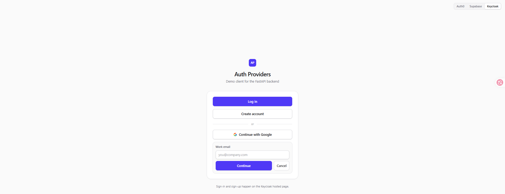
*Frontend: sign-in and the provider switcher in the top right corner*

The backend needs CORS for the frontend: `CORSMiddleware` with `allow_origins=["http://localhost:5173", "http://localhost:5174"]` and the `Authorization` and `Content-Type` headers.

---

## 2. Google OAuth client

*One Google OAuth client can be used by all three providers: it can have several redirect URIs. Google doesn't charge for sign-in.*

#### Step 1. Create the client

Google Cloud Console → **Google Auth Platform → Clients → Create client**, type **Web application**.

#### Step 2. Authorized redirect URIs

These are the **provider's** URLs, not your frontend's: Google returns the user to the provider, and the provider then sends them to the frontend.

| Provider | Redirect URI |
| --- | --- |
| Supabase | `https://<ref>.supabase.co/auth/v1/callback` |
| Keycloak | `http://localhost:8080/realms/auth-providers/broker/google/endpoint` |
| Auth0 (own keys) | `https://<tenant>.us.auth0.com/login/callback` |

**Authorized JavaScript origins** are not needed: they are only for Google One Tap in the browser.

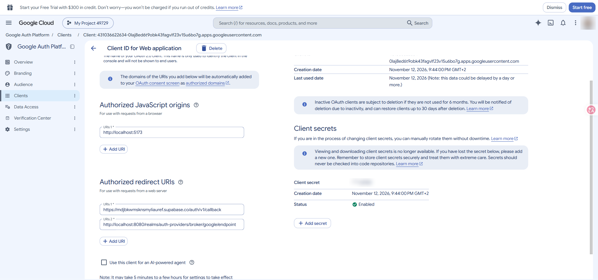
*Google OAuth client: redirect URIs for the providers*

#### Step 3. Branding and Audience

- **Branding → App name** is the name on Google's account chooser. If the callback goes to someone else's domain (`supabase.co`, `auth0.com`), Google shows that domain instead of the name. The name only appears with your own domain and after brand verification.
- **Audience → Publishing status**: in *Testing* only test users (up to 100) can sign in, in *In production* any account can. With basic scopes (`openid email profile`) no app verification is needed.

> **The client secret never goes into code**
>
> It is only pasted into the provider settings (Supabase, Keycloak, Auth0). The downloaded `client_secret_*.json` is not needed in the project: delete it or keep it in `.gitignore`.

---

## 3. Auth0

*A cloud provider with a hosted login page (Universal Login). The easiest to set up; permissions come from RBAC and Actions.*

#### Step 1. Tenant

Sign up at auth0.com and create a tenant. The domain looks like `dev-xxxx.us.auth0.com` and is shown in the top left of the Dashboard.

#### Step 2. API (what the token is issued for)

**Applications → APIs → Create API**:

- Name — anything;
- **Identifier** is the `audience`, e.g. `https://auth-providers-api`. It's just a string: nothing calls it, and it has nothing to do with localhost. **It can't be changed later.**
- JSON Web Token Profile — Auth0, Signing Algorithm — **RS256**.

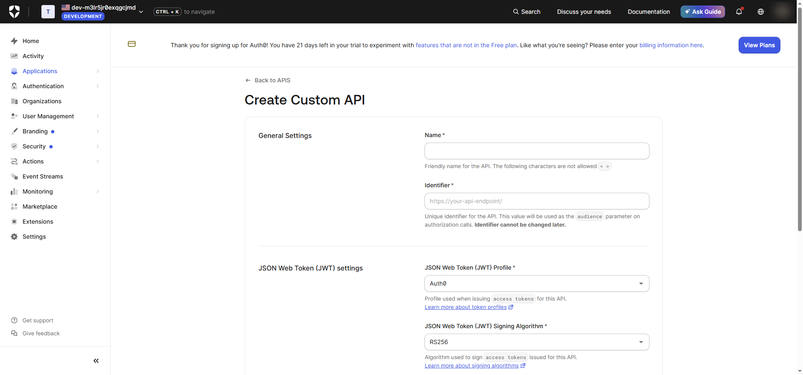
*Creating an API: the Identifier field is the audience*

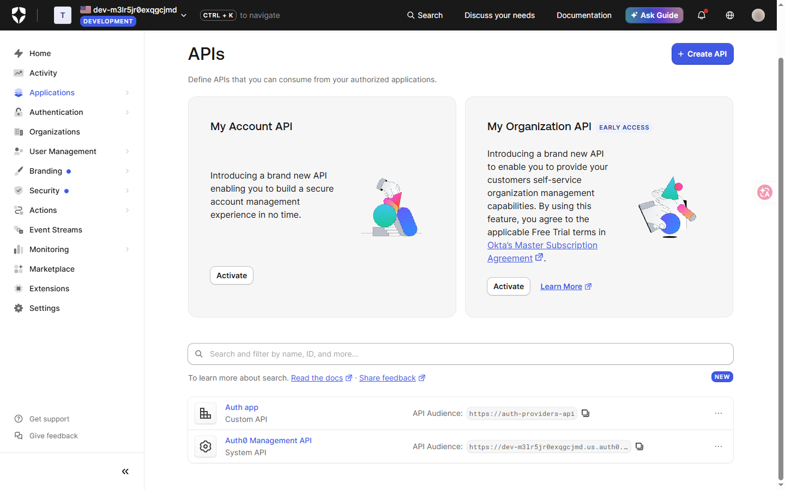
*API list: the API Audience is shown next to the name*

#### Step 3. Application for the frontend (SPA)

**Applications → Applications → Create Application → Single Page Application**. Its Client ID is `VITE_AUTH0_CLIENT_ID`. The SPA doesn't need the client secret.

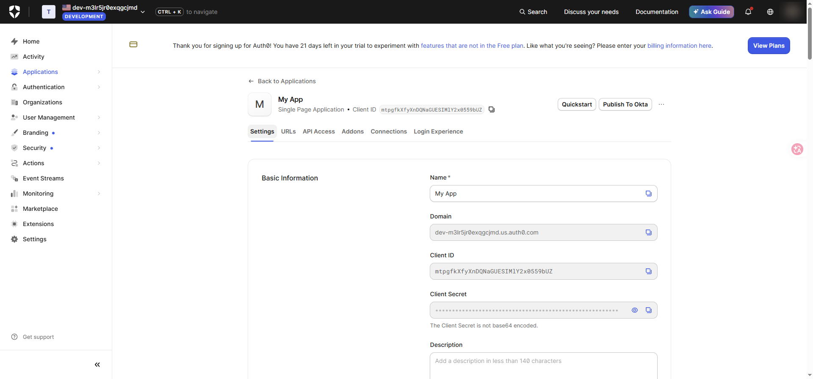
*SPA application settings: Domain and Client ID*

#### Step 4. Application URLs

Put exactly `http://localhost:5173` into **Allowed Callback URLs**, **Allowed Logout URLs** and **Allowed Web Origins**: no path and no trailing slash, because that's the `redirect_uri` the frontend sends. Then **Save Changes**.

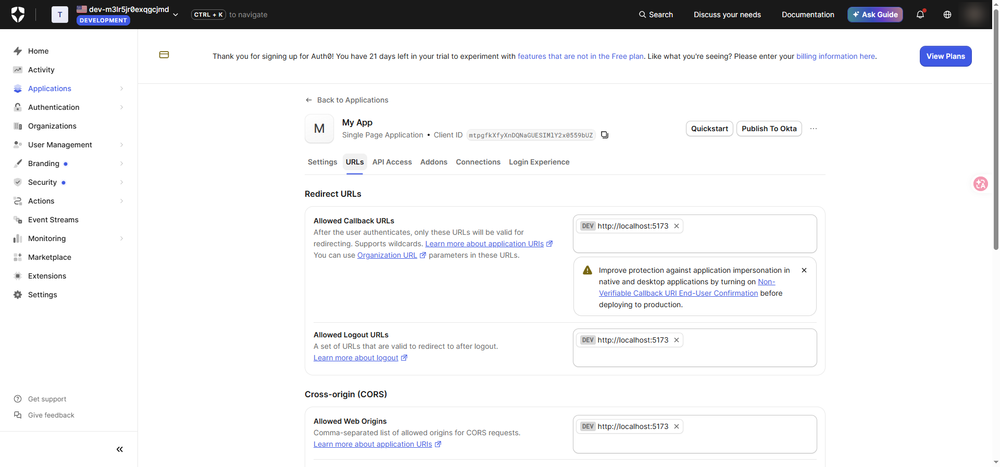
*Callback, Logout and Web Origins: an exact match with the frontend URL*

#### Step 5. Allow the application to access the API

In the application's **API Access** tab (or the API's **Application Access** tab), allow the application User access to your API. Without it, login fails with *Client "…" is not authorized to access resource server*.

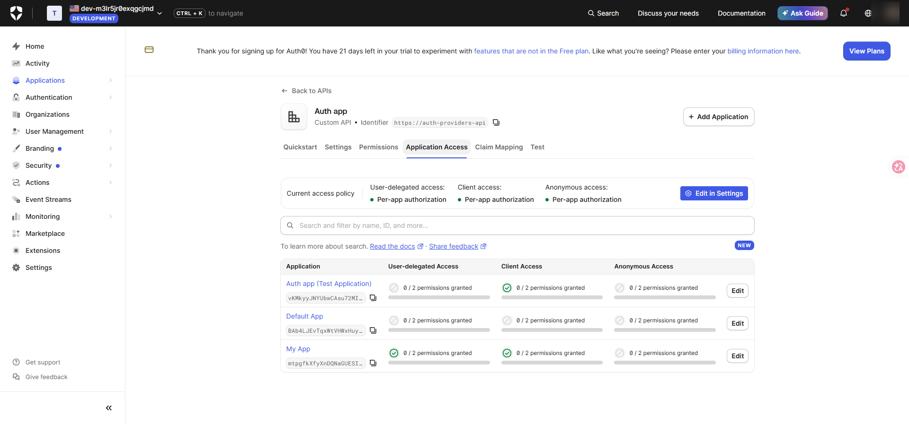
*The API's Application Access: which applications can get tokens for it*

#### Step 6. Sign in with Google

**Authentication → Social**, connection `google-oauth2`. It works right away on **Auth0 developer keys**. For production, enter your own Client ID and Secret from chapter 2 and add the redirect URI `https://<tenant>.us.auth0.com/login/callback` in Google. The connection must be enabled in the application's Connections tab.

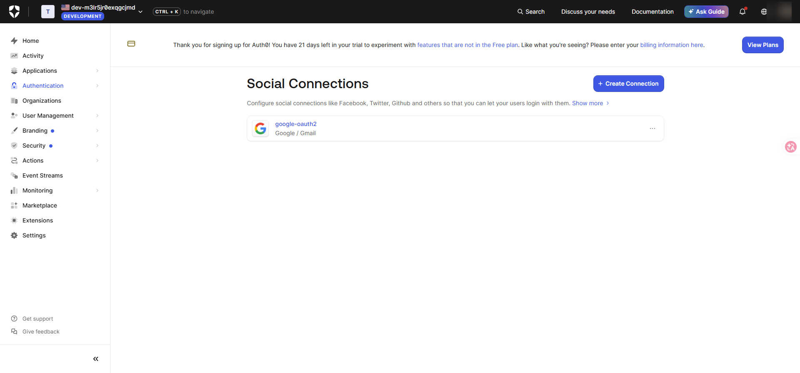
*Social connections: google-oauth2*

#### Step 7. Permissions (RBAC)

- API → **Settings → RBAC Settings**: turn on **Enable RBAC** and **Add Permissions in the Access Token**. Permissions then arrive in the `permissions` claim.
- API → **Permissions**: `read:users`, `write:users`, `read:orders`, `write:orders` — the same strings as in `Scope` on the backend.
- **User Management → Roles**: a role (e.g. `customer`) with these permissions, assigned to users.

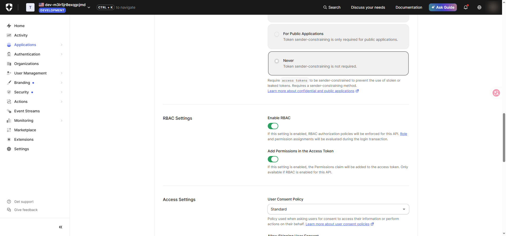
*RBAC: permissions in the access token*

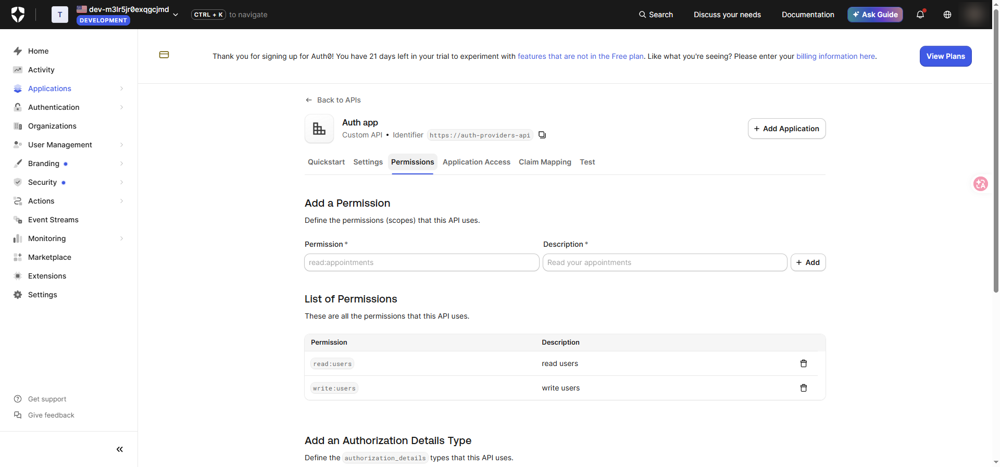
*API permissions*

#### Step 8. Action: email and base permissions in the token

By default an Auth0 access token has no `email`, so every user lands on onboarding. **Actions → Library → Create Action → Build from scratch**, trigger **Login / Post Login**:

```
exports.onExecutePostLogin = async (event, api) => {
  if (event.resource_server?.identifier !== "https://auth-providers-api") return;

  api.accessToken.setCustomClaim("email", event.user.email);
  // base permissions for everyone (special ones, like admin, are better done with roles)
  api.accessToken.addScope("read:orders");
  api.accessToken.addScope("write:orders");
};
```

**Deploy**, then **Actions → Triggers → post-login**: drag the Action between Start and Complete and click **Apply**.

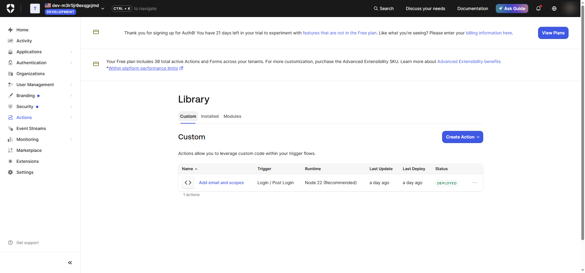
*Actions library*

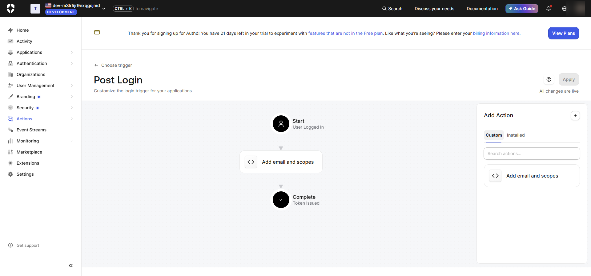
*post-login trigger: the Action in the login flow*

#### Step 9. Backend: `.env.auth0`

```
PROVIDER=auth0
ISSUER=https://<tenant>.us.auth0.com/     # trailing slash is required
ISSUER_PATH=.well-known/jwks.json          # no leading slash
API_AUDIENCE=https://auth-providers-api
ALGORITHMS=["RS256"]
```

### Auth0 specifics

- **Same email = two users.** Password login and Google login get different `sub` values (`auth0|…` and `google-oauth2|…`) and two rows in `users`. Account linking is done manually with an Action and the Management API.
- **Google developer keys** are for development only: the consent screen says Auth0, and some SSO features don't work.
- SPA tokens live 2 hours by default (*Token Expiration For Browser Flows*), regular ones 24 hours. Renewal uses a hidden iframe, which doesn't work in Safari and Brave; refresh tokens are more reliable (`useRefreshTokens` + Allow Offline Access on the API).
- In the Management API users are looked up by `sub`: `GET /api/v2/users/{sub}`.

---

## 4. Supabase

*Cloud Postgres plus Auth. There is no hosted login page, the form lives in your app. Tokens carry no permissions by default; a hook adds them.*

#### Step 1. Project

Create a project at supabase.com (region, database password). The project ref is in the Dashboard URL: `/project/<ref>/…`.

#### Step 2. Keys for the frontend

**Project Settings → API Keys**. Take the **Publishable key** (`sb_publishable_…`) → `VITE_SUPABASE_KEY`, and the Project URL `https://<ref>.supabase.co` → `VITE_SUPABASE_URL`.

**Don't use the Secret key (`sb_secret_…`) anywhere**: it bypasses RLS, and the backend doesn't need it to verify tokens.

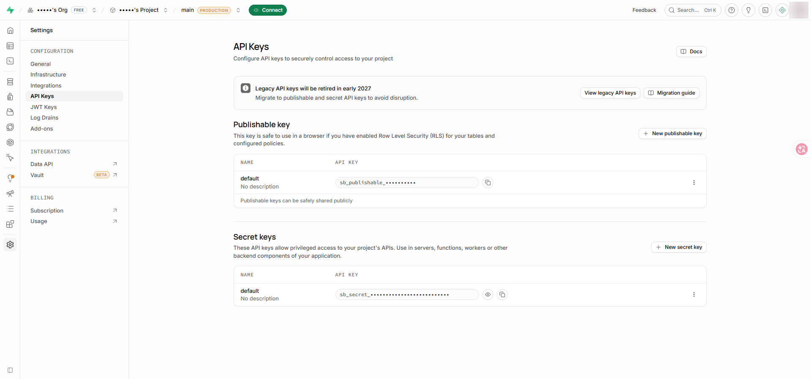
*API Keys: only the Publishable key is needed*

#### Step 3. JWT signing keys

**Project Settings → JWT Keys**: the current key must be **asymmetric** (ECC P-256 → `ES256`, or RSA). With the legacy HS256 secret the JWKS is empty and the backend can't verify a single token.

One-command check: `curl https://<ref>.supabase.co/auth/v1/.well-known/jwks.json` — the response should contain a key with `"alg":"ES256"`.

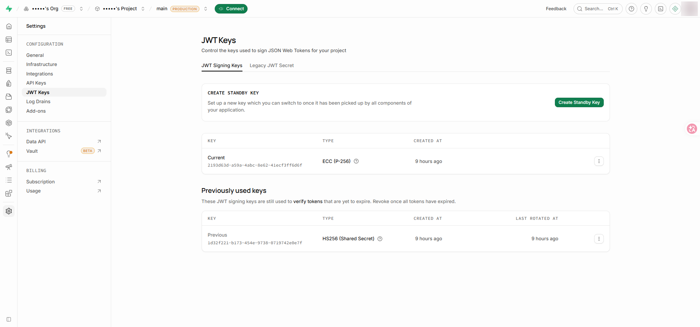
*JWT Keys: an asymmetric signing key*

#### Step 4. Redirect URLs

**Authentication → URL Configuration**: Site URL and Redirect URLs — `http://localhost:5173`.

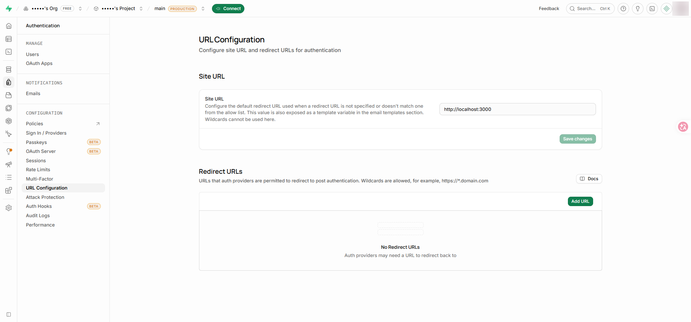
*URL Configuration*

#### Step 5. Email and confirmation

**Authentication → Sign In / Providers**: the Email provider is on by default. **Confirm email** makes users confirm their address; Supabase's built-in mailer sends only a few emails per hour, so you may want to turn it off for testing. Clicking the link in the email signs the user in right away.

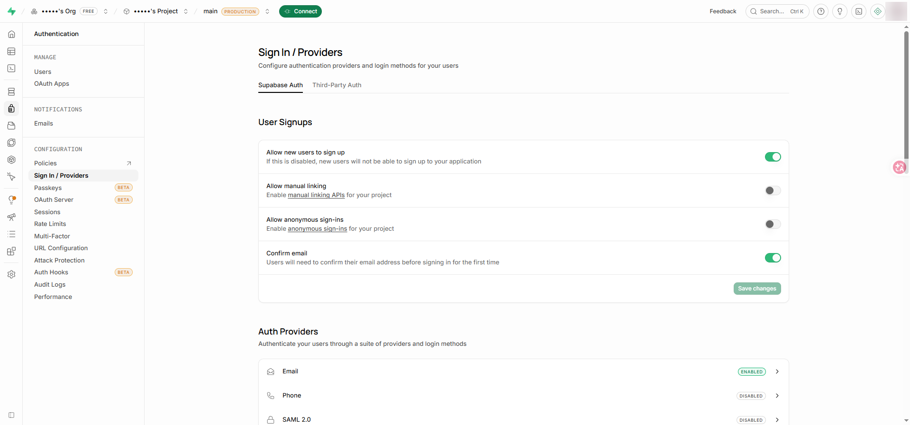
*Sign In / Providers: sign-ups, Confirm email, provider list*

#### Step 6. Google

Unlike Auth0, there are no developer keys: you need your own Google client (chapter 2). In **Sign In / Providers → Google** enable the provider, paste the Client ID and Client Secret, copy the **Callback URL** (`https://<ref>.supabase.co/auth/v1/callback`) into Authorized redirect URIs in Google, and save.

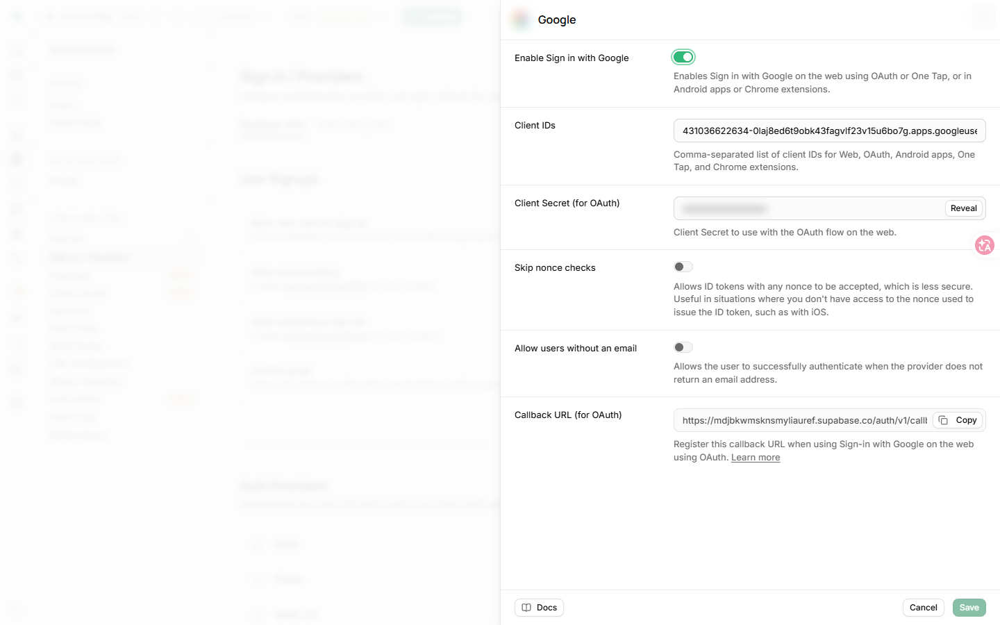
*Google provider in Supabase: Client ID, Secret and Callback URL*

#### Step 7. Permissions in the token: Access Token Hook

A Supabase token only has `role: "authenticated"`. A Postgres function adds the permissions. First, **SQL Editor** → Run:

```
create or replace function public.custom_access_token_hook(event jsonb)
returns jsonb
language plpgsql
stable
as $$
declare
  claims jsonb := event->'claims';
begin
  claims := jsonb_set(
    claims, '{permissions}',
    '["read:users", "write:users", "read:orders", "write:orders"]'::jsonb
  );
  return jsonb_set(event, '{claims}', claims);
end;
$$;

grant usage on schema public to supabase_auth_admin;
grant execute on function public.custom_access_token_hook to supabase_auth_admin;
revoke execute on function public.custom_access_token_hook from authenticated, anon, public;
```

Then **Authentication → Auth Hooks → Add hook → Customize Access Token (JWT) Claims hook**: type Postgres, schema `public`, function `custom_access_token_hook`. Then sign out and back in. To make permissions depend on a role, the function reads it from your own table by `event->>'user_id'`.

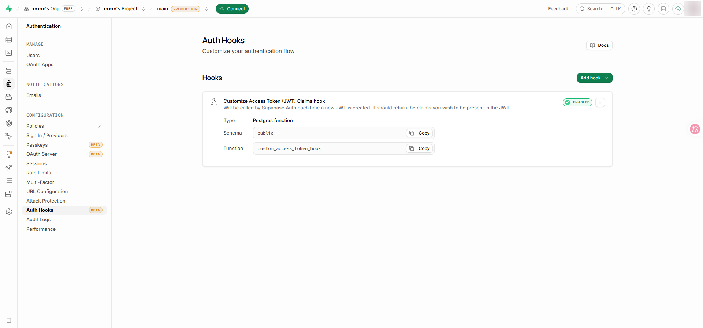
*Auth Hooks*

#### Step 8. Backend: `.env.supabase`

```
PROVIDER=supabase
ISSUER=https://<ref>.supabase.co/auth/v1   # no trailing slash
ISSUER_PATH=/.well-known/jwks.json           # with a leading slash
API_AUDIENCE=authenticated
ALGORITHMS=["ES256"]
```

PyJWT needs the `cryptography` package for ES256.

### Supabase specifics

- **Same email = one account.** If Google returns a verified email that already exists, Google is added to the same user as another identity and `sub` stays the same. An unverified email identity is removed in that case so it can't be hijacked.
- **The email is in the token right away**, so onboarding is usually not needed.
- Google's screen says *Sign in to <ref>.supabase.co*. Your own name only comes with a Custom Domain (paid Pro add-on).
- A free project is paused after about a week of inactivity; production needs Pro.

---

## 5. Keycloak: basics

*Self-hosted. Everything is in your hands, so there's the most to configure. There's no separate "API" entity like in Auth0: there are only clients, and aud is added by a mapper.*

#### Step 1. Running it in docker-compose

```
  keycloak:
    image: quay.io/keycloak/keycloak:26.4
    command: start-dev
    env_file: [.env]          # KC_BOOTSTRAP_ADMIN_USERNAME / _PASSWORD
    environment:
      KC_HOSTNAME: http://localhost:8080
      KC_HOSTNAME_BACKCHANNEL_DYNAMIC: "true"
    ports: ["8080:8080"]
    volumes: [keycloakdata:/opt/keycloak/data]
    networks: [app]
```

`KC_HOSTNAME` pins `iss` in tokens to `http://localhost:8080/…`, even when the backend reaches Keycloak inside docker as `keycloak:8080`. Admin console: `http://localhost:8080`.

#### Step 2. Realm

Realm dropdown in the top left → **Create realm** → `auth-providers`. This is your app's realm: clients, scopes, IdPs. Don't create anything of your own in `master`.

#### Step 3. Client for the frontend

**Clients → Create client**:

- Client type OpenID Connect, Client ID `auth-providers-spa`;
- **Client authentication: Off** (public client), **Standard flow: On**, PKCE Method `S256` under Advanced;
- **Valid redirect URIs** and **Valid post logout redirect URIs**: `http://localhost:5173/*`;
- **Web origins**: `http://localhost:5173`.

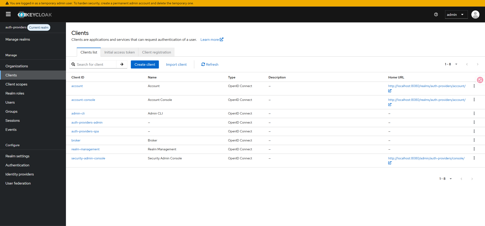
*Clients of the auth-providers realm*

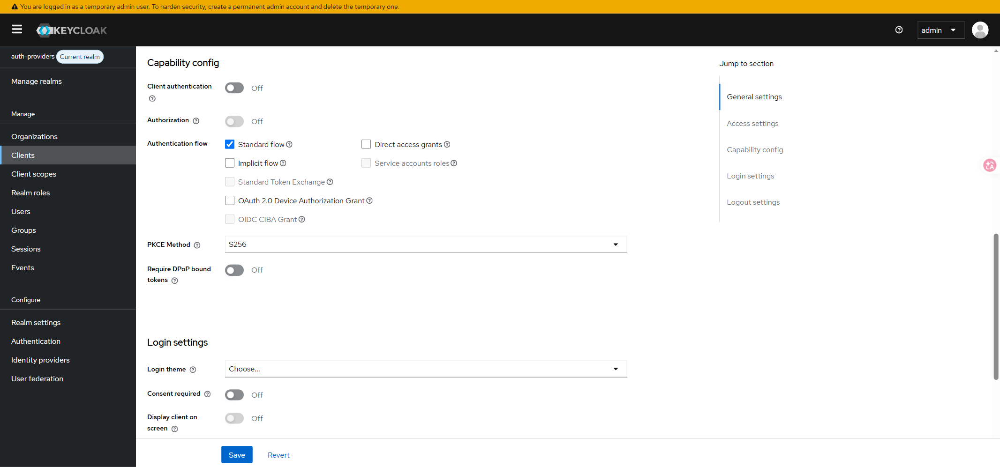
*Capability config: a public client with Standard flow*

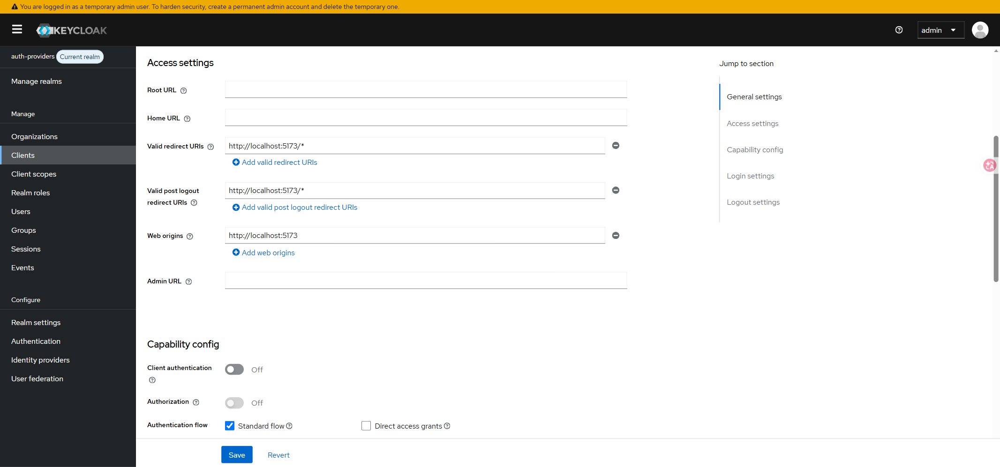
*Access settings: redirect URIs, post logout URIs, web origins*

#### Step 4. Audience (`aud`) for your API

Without this step the token has `aud: "account"`, and the backend rejects it with *Audience doesn't match*.

1. **Client scopes → Create client scope**: name `auth-providers-api`, protocol OpenID Connect.
2. Inside it, **Mappers → Configure a new mapper → Audience**: fill in **Included Custom Audience** = `auth-providers-api` (not Included Client Audience), **Add to access token: On**, then **Save**.

The scope name and the mapper name are just labels. Only the Included Custom Audience value affects the token, and it must match `API_AUDIENCE`.

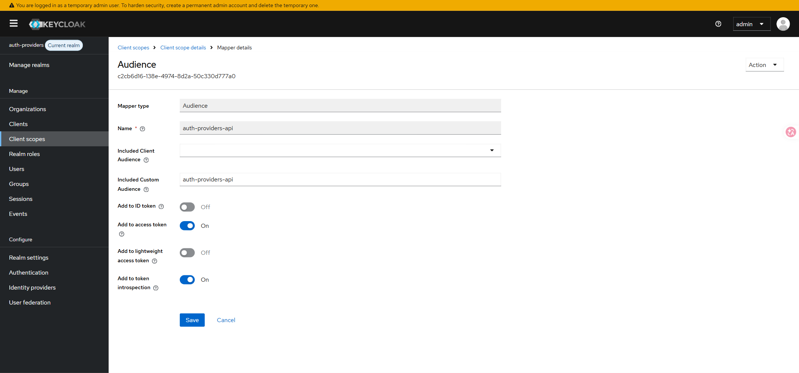
*Audience mapper: Included Custom Audience and Add to access token*

#### Step 5. Permission scopes

Create client scopes `read:users`, `write:users`, `read:orders`, `write:orders`, and turn on **Include in token scope: On** for each. Keycloak lists them in the `scope` claim by itself, and the backend needs no changes.

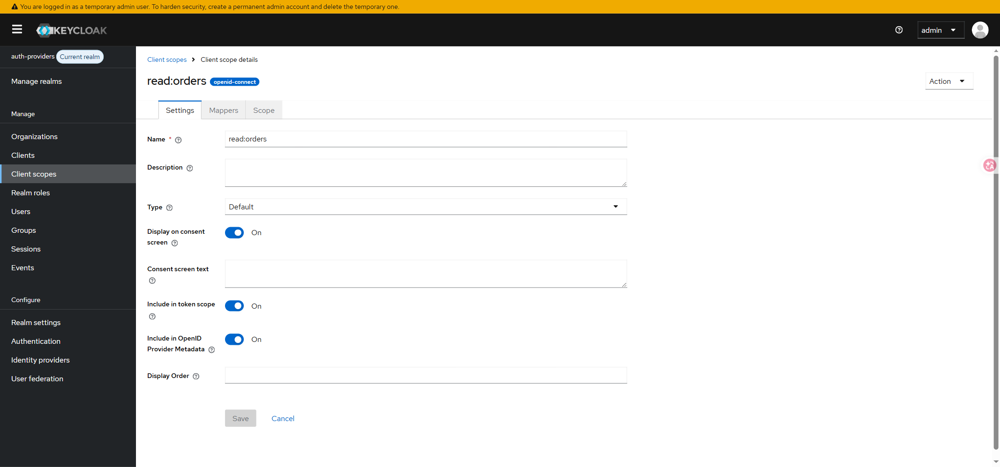
*Client scope: Include in token scope*

#### Step 6. Assign the scopes to the client

**Clients → auth-providers-spa → Client scopes → Add client scope**: select `auth-providers-api` and all four permissions → **Add → Default**. Optional scopes only end up in the token when they are requested explicitly.

Check without logging in: the **Evaluate** tab in the same place → pick a user → **Generated access token**. Look at `aud` and `scope`.

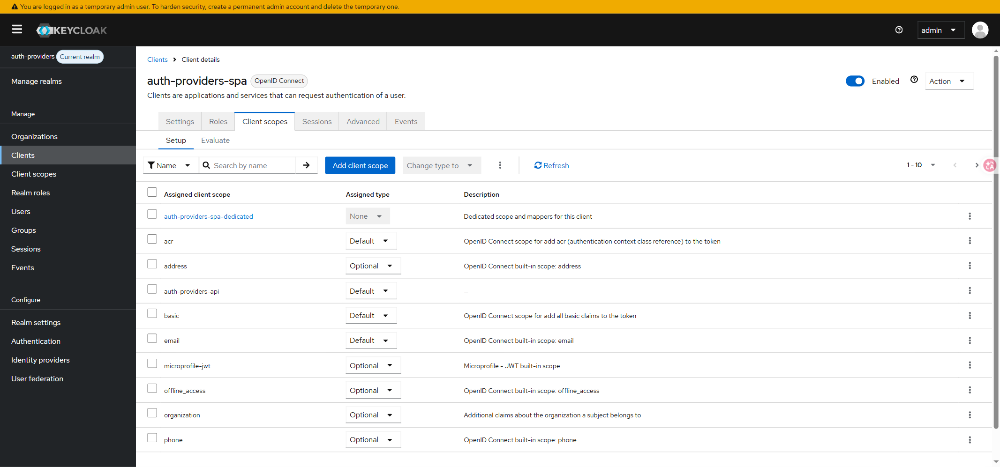
*Client scopes: everything needed is assigned as Default*

#### Step 7. Registration

**Realm settings → Login → User registration: On**. The "Create account" button on the frontend opens the registration form directly (`prompt=create`). **Verify email** needs SMTP (Email tab); for local testing a Mailpit container works: host `mailpit`, port `1025`, emails at `http://localhost:8025`.

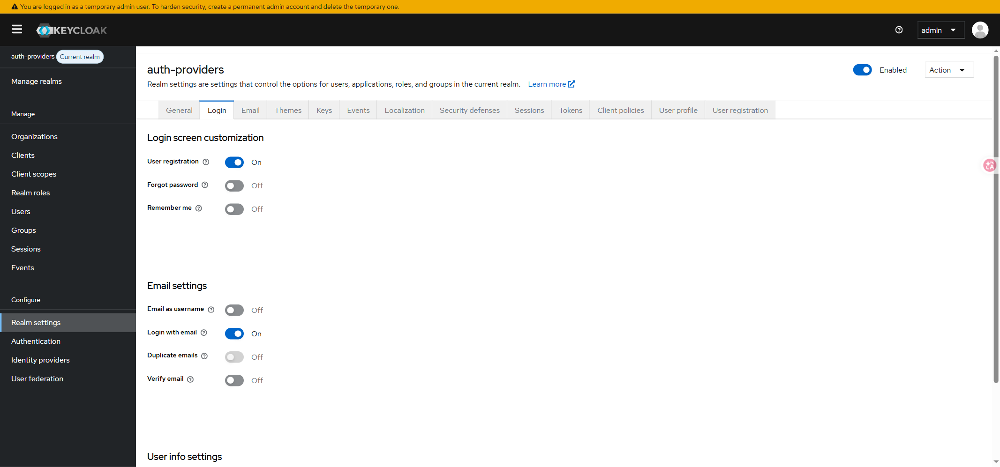
*Realm settings → Login*

#### Step 8. Google

**Identity providers → Google**: Client ID and Secret from chapter 2. Copy the Redirect URI (`…/broker/google/endpoint`) into Google. Set **Advanced → Prompt** to `select_account` if Google should ask for the account every time. The frontend goes straight to Google, skipping the Keycloak page (`kc_idp_hint=google`).

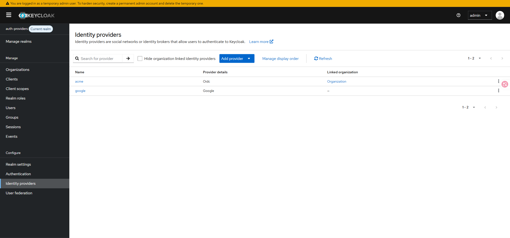
*Identity providers of the realm*

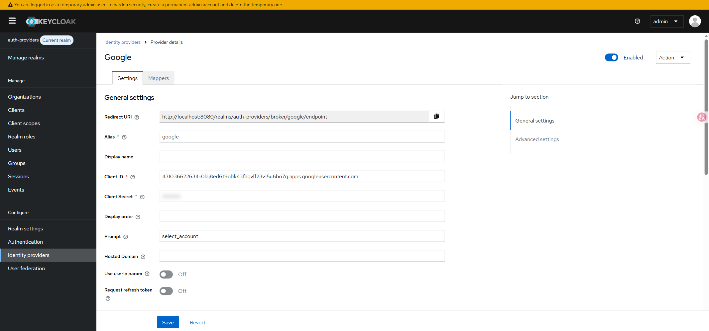
*Google as an identity provider: the Redirect URI for Google Console*

#### Step 9. Backend: `.env` for Keycloak

```
PROVIDER=keycloak
ISSUER=http://localhost:8080/realms/auth-providers          # as the browser sees it (= iss)
ISSUER_PATH=http://keycloak:8080/realms/auth-providers/protocol/openid-connect/certs
API_AUDIENCE=auth-providers-api
ALGORITHMS=["RS256"]
```

Two different URLs are not a mistake. The browser reaches Keycloak at `localhost:8080`, and that's what goes into `iss`. Inside the `api` container, `localhost` points at `api` itself, so the keys must be fetched via the `keycloak` service name. If the backend runs outside docker, `ISSUER + /protocol/openid-connect/certs` is enough.

### Keycloak specifics

- **Same email**: Keycloak asks the user to sign in to the existing account to confirm linking (First Broker Login). Automatic linking: Trust Email on the IdP + your own flow with *Automatically set existing user*, and only together with Verify email.
- **The email is in the token right away** (`email` scope).
- **Logout** ends the Keycloak session but not Google's: on the next login Google lets the user in without a password.
- The access token lives 5 minutes; the frontend renews it with the refresh token (no iframe, no third-party cookies).

---

## 6. Keycloak: SSO

### A. One login for several apps

#### Step 1. Second client

A client `auth-providers-admin` with the same settings but with `http://localhost:5174/*` URLs and Web origins `http://localhost:5174`. Assign the same Default scopes to it, including `auth-providers-api`, or the backend will reject its tokens.

#### Step 2. Second frontend

`frontend/.env.admin.local` (example in `.env.admin.example`) and `npm run dev:admin` on port 5174:

```
VITE_APP_NAME=Auth Providers Admin
VITE_DEFAULT_PROVIDER=keycloak
VITE_KEYCLOAK_CLIENT_ID=auth-providers-admin
```

#### Step 3. Check

Sign in on 5173, open 5174 and click Log in: Keycloak lets you in without the form. The other app notices a logout when you switch to its tab: the refresh token is rejected and the frontend sends the user to sign in. The backend needs nothing: `iss` and `aud` are the same, only `azp` differs.

### B. Enterprise SSO ("sign in with your company")

It's a chain of trust: `company IdP → your Keycloak (broker) → your backend`. The backend still sees only its own realm. In the demo, the company is played by a second realm, `acme-corp`; with a real company (Okta, Entra ID, Google Workspace) steps 1–2 are done by its admin, and users don't have to be created manually: they are created on first login.

#### Step 1. The "company": realm `acme-corp`

- User `alice@acme.com`: Email verified On and **a password in the Credentials tab** (Temporary Off).
- Client `auth-providers-broker`: **Client authentication: On**, Standard flow On;  
  Valid redirect URIs: `http://localhost:8080/realms/auth-providers/broker/acme/endpoint`;  
  Valid post logout redirect URIs: `http://localhost:8080/realms/auth-providers/broker/acme/endpoint/*`.

Scopes and `auth-providers-api` are not needed in this realm: its tokens are seen only by the broker, not by your API.

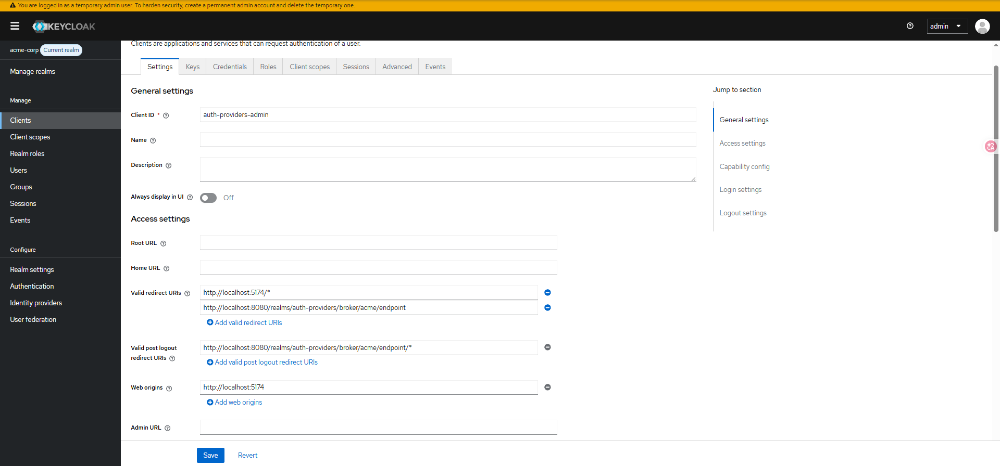
*acme-corp: the client for the broker (named auth-providers-admin in the demo): broker redirect and post logout URIs*

#### Step 2. Broker: identity provider in `auth-providers`

**Identity providers → OpenID Connect v1.0**: alias `acme`, Discovery endpoint `http://localhost:8080/realms/acme-corp/.well-known/openid-configuration`, Client ID `auth-providers-broker`, Client Secret from that client's Credentials tab. To avoid an extra redirect on logout you can turn on **Backchannel logout**.

#### Step 3. Organization and domain

**Realm settings → Organizations: On → Organizations → Create**: `Acme`, domain `acme.com`. In its Identity providers tab, link `acme` with domain `acme.com` and turn on **Redirect when email domain matches**. The organization is useful for the backend too: the `organization` scope adds a claim with the same name.

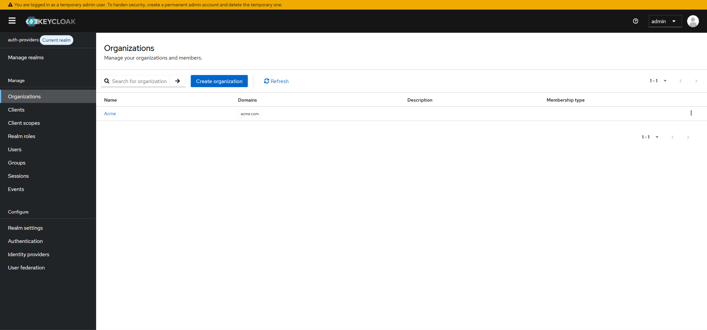
*Organizations of the realm*

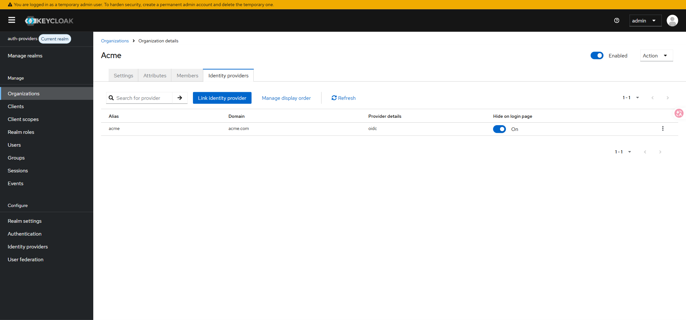
*The acme IdP is linked to the acme.com domain*

#### Step 4. Frontend: picking the IdP by domain

In our Keycloak, domain-based redirect through Organizations didn't work (the regular form was shown even with `login_hint`), so the company is resolved on the frontend. This is common practice, known as "home realm discovery":

```
VITE_KEYCLOAK_SSO_DOMAINS=acme.com:acme,globex.com:globex
```

**Sign in with SSO** → work email → the frontend finds the alias by domain and sends `kc_idp_hint`. An unknown domain opens the regular form with the email prefilled.

> **What happens with real companies**
>
> SAML instead of OIDC (certificates must be renewed on time), different email claims (in Entra it can be `upn` or `preferred_username`), removing people who left (full sync is SCIM, which Keycloak doesn't ship), and Entra secrets that live at most two years.

### Keycloak in production

- Settings live in Keycloak's database. Migration: `kc.sh export --dir /opt/keycloak/data/export --users realm_file`, and on the new server `start --import-realm` from `/opt/keycloak/data/import`. An export from the admin console (Partial export) masks secrets.
- `start` instead of `start-dev`, HTTPS (your own certificate or a reverse proxy with `KC_PROXY_HEADERS=xforwarded`), a real `KC_HOSTNAME`, Postgres (`KC_DB=postgres`, `KC_DB_URL` and so on).
- The new URL must be set in client redirect URIs, in Google, and in `ISSUER`/`VITE_KEYCLOAK_URL`.

---

## 7. Comparison

|  | Auth0 | Supabase | Keycloak |
| --- | --- | --- | --- |
| Hosting | cloud | cloud (+ Postgres) | yours (docker) |
| Login page | hosted (Universal Login) | your own form in the app | hosted (Keycloak themes) |
| Google | right away (developer keys) | own client only | own client only |
| `aud` | API Identifier | `authenticated` | Audience mapper |
| Algorithm | RS256 | ES256 | RS256 |
| Email in the access token | no, via an Action | yes | yes |
| Permissions | RBAC + Actions | Access Token Hook | client scopes / roles |
| Same email | two users | auto-linking | asks to confirm |
| SSO across apps | yes | no | yes |
| Enterprise SSO | Enterprise connections (paid) | SAML on Pro | broker, free |
| Price | gets expensive as you grow | Free / Pro ~$25 | free, but your own infrastructure |

For a startup Supabase is usually the most convenient: database, auth and storage in one place, with clear pricing. Auth0 is the fastest to set up but gets expensive. Keycloak is for when you need full control and enterprise SSO at no extra cost, and running your own infrastructure doesn't scare you.

> **Plans, balances, premium — in your own DB, not at the provider**
>
> A token lives for hours, while paid permissions must take effect immediately. The provider handles sign-in and staff roles (moderator, admin), while `plan`, `plan_expires_at` and credits (a transaction log + a balance with atomic deduction) stay with you.

---

## 8. Errors and how to fix them

*We ran into all of these while building the project.*

| Symptom | Cause | Fix |
| --- | --- | --- |
| **Auth0** | | |
| *Callback URL mismatch* | Wrong URL in Allowed Callback URLs (e.g. with a `/me` path) | Exactly `http://localhost:5173`, same in Logout URLs and Web Origins |
| *Service not found: https://…* | No API with that Identifier | Create the API (Applications → APIs) with this Identifier |
| *Client "…" is not authorized to access resource server* | The application isn't allowed to access the API | The application's API Access tab or the API's Application Access tab |
| Backend: *Name or service not known* when loading JWKS | `ISSUER` has no trailing slash, so the domain becomes `…auth0.com.well-known` | `ISSUER=https://<tenant>.us.auth0.com/` |
| Everyone lands on onboarding | No `email` in the access token | An Action with `setCustomClaim("email", …)` |
| **Permissions (all providers)** | | |
| `InsufficientScopeException` (500 without a handler) | The token lacks the required permission | Auth0: RBAC + permissions or an Action; Supabase: the hook; Keycloak: Default scopes with Include in token scope. Then sign out and back in. The handler should return 403 |
| **Supabase** | | |
| Backend rejects every token, JWKS is empty | Legacy HS256 secret | JWT Keys → an asymmetric key (ECC P-256) |
| Google: *provider is not enabled* | Provider not enabled or no Client ID/Secret | Sign In / Providers → Google |
| Confirmation emails don't arrive | Built-in mailer rate limit | Turn off Confirm email while testing or set up SMTP |
| **Keycloak** | | |
| *InvalidAudienceError: Audience doesn't match*, the token has `aud: account` | The Audience mapper is empty or the scope isn't Default | Included Custom Audience = `auth-providers-api`, scope as Default |
| Only some permissions in `scope` | Include in token scope is off on the scope | Turn it on for every permission scope |
| Backend in docker can't fetch JWKS (*Connection refused*) | `localhost` inside the container is `api` itself | `ISSUER_PATH=http://keycloak:8080/…/certs` |
| Logout: *Invalid redirect uri* | Valid post logout redirect URIs is empty | `http://localhost:5173/*` |
| Signed back in right after logout | A race in the frontend (fixed) or a live Google session | Prompt `select_account` on the Google IdP |
| Broker: *Client not found* on the company page | The IdP's Client ID doesn't match the client in `acme-corp` | Check the Client ID and Secret |
| Broker: *Invalid username or password* | The company user has no password | Users → Credentials → Set password |
| Broker: *Invalid redirect uri* on logout | The broker client has no post logout URI | `…/broker/acme/endpoint/*` or Backchannel logout |
| The `auth-providers` login form doesn't let `alice` in | She doesn't exist in this realm | Use the `acme` IdP button or "Sign in with SSO" |
| **Infrastructure** | | |
| *The SQLAlchemy asyncio module requires … greenlet* | greenlet became optional in SQLAlchemy 2.1 | `uv add "sqlalchemy[asyncio]"` |
| *stat ./entrypoint.sh: no such file or directory* | No `WORKDIR` in the runner stage | `WORKDIR /app`, and `alembic` without `uv run` in the entrypoint |
| Frontend: "Could not reach the API" | CORS, or the backend isn't running | `CORSMiddleware` with the frontend URLs |
